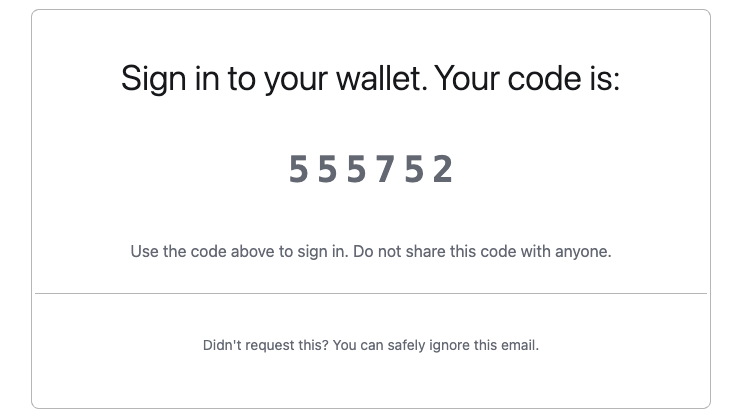

Email authentication uses a one-time password (OTP) sent to the user's email address. The client encrypts the code before submitting it for verification, then proves possession of its signing key to create a session.

Codes are 6-9 characters long and either numeric or alphanumeric (Crockford's Base32).

<Note>
  Updating an existing integration? Legacy OTP activities, credential-bundle email authentication, and email recovery are deprecated; do not start a new integration with them. If you are moving off those flows, or upgrading SDK Browser/Server/React from before 6.0, SDK React Native from before 1.5.21, or Wallet Kit/Core from before 2.0, follow the [OTP migration guide](/features/authentication/otp-migration-guide) for SDK upgrades, activity versions, client signatures, and policy changes.
</Note>

**Sandbox testing**

To test OTP codes in our sandbox environment you can use the following:

- `alphanumeric` must be set to `false`
- `otpLength` must be set to `6`
- Email: [user@example.com](mailto:user@example.com)
- OTP Code: `000000` 

<Warning>
  OTP sandbox organizations can create real wallets and hold real assets. We recommend using them for testing only and avoiding real funds. See the [shared responsibility model](/security/shared-responsibility-model) for more information.
</Warning>

## Core mechanism

The low-level authentication flow uses three activities. Wallet Kit and Core manage encryption and session creation for you; see the [SDK-specific login behavior](/features/authentication/otp-migration-guide#wallet-kit-and-core-login-activities).

<Steps>
  <Step>
    `INIT_OTP_V3` sends a 6-9 digit or alphanumeric OTP to the user's email address and returns an encryption target bundle.
  </Step>
  <Step>
    The client encrypts the OTP and a client-generated public key using that bundle. `VERIFY_OTP_V2` verifies the encrypted submission and returns a verification token bound to the client key.
  </Step>
  <Step>
    `OTP_LOGIN_V2` validates the verification token and client signature, registers the session public key, and returns a session JWT. The signing private key remains on the client; there is no credential bundle to decrypt.
  </Step>
</Steps>

### Email recovery

In Turnkey, email recovery **does not refer to a separate, recovery-only email address** (as commonly used in consumer products, where a recovery email can reset access but cannot itself be used to sign in).
Instead, it means **adding email as an authentication method for a user**. Once added, that user can authenticate using email by default, alongside any other configured authenticators (such as passkeys, social logins or external wallets).

To replace a lost authenticator, authenticate into a session scoped to authenticator enrollment, complete any required MFA challenges, and enroll a replacement with `ACTIVITY_TYPE_CREATE_AUTHENTICATORS_V2`. See [Replace email recovery](/features/authentication/otp-migration-guide#replace-email-recovery) for the full sequence and policy requirements.

If you are designing a flow for users who have lost access to their primary authenticator, see [MFA Recovery](/features/authentication/mfa/enforcement-and-recovery). It covers requiring a second independent factor for recovery, landing recovery in a session scoped to authenticator enrollment only, and treating recovery as a security event.

## Prerequisites

Make sure you have set up your primary Turnkey organization with at least one API user that can programmatically initiate OTP and create suborganizations. Check out our [Quickstart guide](/get-started/quickstart) if you need help getting started.

For OTP signup and login flows you will need a user with the following policy:

```json
{
  "effect": "EFFECT_ALLOW",
  "consensus": "approvers.any(user, user.id == '<YOUR_API_USER_ID>')",
  "condition": "(activity.resource == 'AUTH' && activity.action == 'CREATE') || (activity.resource == 'OTP' && activity.action == 'CREATE') || (activity.resource == 'OTP' && activity.action == 'VERIFY') || (activity.resource == 'ORGANIZATION' && activity.action == 'CREATE')"
}
```

<Note>Avoid using an API key that is also present in the sub-organization that you're targeting within the email activities. Turnkey identifies the user from the request signature and in case of an identical API key it will always prioritize the sub-organization user matching. As a result, it will try to evaluate the sub-organization policies instead of the parent ones.</Note>

## User experience

### OTP-based authentication flow

The flow begins with a new activity of type `ACTIVITY_TYPE_INIT_OTP_V3` using the parent organization id with these parameters:

- `otpType`: specify `"OTP_TYPE_EMAIL"`
- `contact`: user's email address
- `appName`: required application name, at the top level of the activity parameters
- `emailCustomization`: optional parameters for customizing emails
- `userIdentifier`: optional parameter for rate limiting SMS OTP requests per user. We recommend generating this server-side based on the user's IP address or public key. See the [OTP Rate Limits](#otp-rate-limits) section below for more details.
- `alphanumeric`: optional parameter for making this code alphanumeric or not. default: true
- `otpLength`: optional parameter for selecting the length of the OTP. default: 9
- `expirationSeconds`: optional validity window (defaults to 5 minutes)
- `sendFromEmailAddress` : optional custom email address from which to send the OTP email
- `sendFromEmailSenderName` : optional custom sender name for use with sendFromEmailAddress; if left empty, will default to ‘Notifications’
- `replyToEmailAddress` : optional custom email address to use as reply-to

The response to `ACTIVITY_TYPE_INIT_OTP_V3` includes an `otpEncryptionTargetBundle` which is used in OTP verification. After receiving the OTP, users complete OTP verification with `ACTIVITY_TYPE_VERIFY_OTP_V2` using the parent organization id which returns a verificationToken JWT:

- `otpId`: ID from the init activity
- `encryptedOtpBundle`: bundle generated using the otpEncryptionTargetBundle received during `ACTIVITY_TYPE_INIT_OTP_V3` and contains the 6-9 digit or alphanumeric code received via email, and the public key of a client-side generated keypair.
- `expirationSeconds`: optional validity window (defaults to 1 hour)

<Note>
  Plaintext OTP material must remain on the client; send the code to your application server only inside `encryptedOtpBundle`, alongside the `otpId`.
</Note>

After receiving the verification token, users complete OTP authentication flow with `ACTIVITY_TYPE_OTP_LOGIN_V2` using the user's sub-organization ID. Resolve it after verification with `getSubOrgIds`, filtered by `EMAIL`. If no account exists, follow the signup path instead. Login requires:

- `publicKey`: public key to add to organization data associated with the signing key in IndexedDB or SecureStorage.
- `verificationToken`: JWT returned from successful `ACTIVITY_TYPE_VERIFY_OTP_V2` activity
- `clientSignature`: This proves authorization for the verification token being used, and is generated using the keypair whose public key was provided in the `encryptedOtpBundle` during verification. 
- `expirationSeconds`: optional validity window (defaults to 15 minutes)
- `invalidateExisting`: optional boolean to invalidate previous login sessions

<Note>
  For signup, the same `verificationToken` from `ACTIVITY_TYPE_VERIFY_OTP_V2` is passed to `ACTIVITY_TYPE_CREATE_SUB_ORGANIZATION_V8`, which requires a signature from the verification-bound client key.
</Note>

<Frame>
  
</Frame>

### Sub-organization initiated OTP

By default, the OTP flow is performed by the parent organization using an API key with sufficient permissions. Sub-organizations can also run the full flow directly — the sub-org's root user (or any user with a policy permitting OTP creation and verification) can initiate it without involving the parent backend.

All activities are stamped using valid sub-organization credentials, with `organizationId` set to the sub-org ID throughout:

<Steps>
  <Step>
    Call `ACTIVITY_TYPE_INIT_OTP_V3` with `organizationId` set to the sub-org ID, stamped with the sub-org's API key
  </Step>
  <Step>
    Encrypt the code and client public key on the client. Call `ACTIVITY_TYPE_VERIFY_OTP_V2` with `otpId` and `encryptedOtpBundle`, stamped with the same sub-org API key, to receive a `verificationToken`
  </Step>
  <Step>
    Use the `verificationToken` to complete one of the following:
    - `ACTIVITY_TYPE_OTP_LOGIN_V2` — authenticate and create a new session, including the required `clientSignature` made by the verification-bound key
    - `ACTIVITY_TYPE_UPDATE_USER_EMAIL` — verify and update the user's email address
    - `ACTIVITY_TYPE_UPDATE_USER_PHONE` — verify and update the user's phone number

    <Note>
      The `verificationToken` is scoped to the issuing organization. Parent-issued tokens can be used by any sub-organization; sub-org-issued tokens are limited to that sub-org only.
    </Note>
  </Step>
</Steps>

### OTP rate limits

In order to safeguard users, Turnkey enforces rate limits for OTP auth activities. If a `userIdentifier` parameter is provided, the following limits are enforced:

- 3 requests per 3 minutes per unique `userIdentifier`
- 3 retries max per code, after which point that code will be locked
- 3 active codes per user, each with a 5 minute TTL

## Email customization

<a id="breaking-change-appname-required" />

### Breaking change: `appName` required

`INIT_OTP_V3` requires `appName` at the top level of the activity parameters. For Auth Proxy integrations, configure the application name in **Dashboard → Embedded Wallets → Configuration**. For the Server SDK, pass it directly to `initOtp`.

The following example uses `@turnkey/sdk-server` 6.0.0 or later. `turnkey` is the server-side instance configured with your parent organization's API key:

```ts
const { otpId, otpEncryptionTargetBundle } = await turnkey.apiClient().initOtp({
  otpType: "OTP_TYPE_EMAIL",
  contact: "user@example.com",
  appName: "Example App",
  emailCustomization: {
    logoUrl: "https://example.com/logo.png",
  },
});
```

Return both `otpId` and `otpEncryptionTargetBundle` to the client and retain them for the same attempt. On resend, replace both values. Continue with [client-side encryption and verification](#otp-based-authentication-flow).

`emailCustomization.logoUrl` accepts a PNG with a maximum width of 340px and height of 124px. For the complete customization fields, see [Init generic OTP](/api-reference/activities/init-generic-otp). For an existing integration, follow the [migration guide](/features/authentication/otp-migration-guide) rather than updating only `appName`.

### Email templates

We also support custom HTML email templates for [Enterprise](https://www.turnkey.com/pricing) clients on the **Scale** tier. This allows you to inject arbitrary data from a JSON string containing key-value pairs. In this case, the `emailCustomization` variable may look like:

```js
...
emailCustomization: {
  templateId: <HTML-template-stored-in-turnkey>,
  templateVariables: "{\"username\": \"alice and bob\"}"
}
...
```

In this specific example, the value `alice and bob` can be interpolated into the email template using the key `username`, referenced in the template with `{{ index .TemplateVariables "username" }}`.

The use of such template variables is purely optional.

Here's an example of a custom HTML email template that includes the OTP code, referenced within the markup as `{{ .OtpCode }}`.
For best compatibility across email providers, make sure to use PNG images within your templates.

<Frame>
  
</Frame>

<Warning>
  **Bespoke HTML templates** and **custom email sender domains** are available to [**Enterprise clients**](https://www.turnkey.com/pricing) on the **Scale tier** or higher.
</Warning>

If you are interested in implementing bespoke, fully-customized email templates, please reach out to [hello@turnkey.com](mailto:hello@turnkey.com).

### Custom email sender domain

[Enterprise](https://www.turnkey.com/pricing) clients  can also customize the email sender domain. To get set up, please reach out to your Turnkey rep to get started but here is what you'll be able to configure:

```js
// Optional custom email address from which to send the OTP email
"sendFromEmailAddress": "notifs@mail.domain.com"

// Optional custom sender name
"sendFromEmailSenderName": "MyApp Notifications"

// Optional reply-to email address
"replyToEmailAddress": "reply@mail.domain.com"
```

Please keep in mind that:

- Email has to be from a pre-whitelisted domain
- If there is no `sendFromEmailAddress` or it's invalid, the other two fields are ignored
- If `sendFromEmailSenderName` is absent, it defaults to "Notifications" (again, ONLY if `sendFromEmailAddress` is present and valid)
- If `replyToEmailAddress` is absent, then there is no reply-to added. If it is present, it must ALSO be from a valid, whitelisted domain, but it doesn't have to be the same email address as the `sendFromEmailAddress` one (though once again, this first one MUST be present, or the other two feature are ignored)
- **Sender name screening:** Some email clients (e.g. Gmail) screen sender names more aggressively than others (e.g. Apple Mail), which can lead to inconsistent display across clients. To ensure a consistent experience, keep your `sendFromEmailSenderName` "safe looking" — avoid underscores, special symbols, or unusual formatting that may cause it to be filtered or hidden.

If you are interested in implementing bespoke, fully-customized email templates and sender domain, please reach out to [hello@turnkey.com](mailto:hello@turnkey.com).

## Authorization and organization settings

A root user satisfying the root quorum, or an API user with the required policies, can submit OTP activities. Parent-initiated login is evaluated against the parent organization's policies even though login targets the user's sub-organization. See [Prerequisites](#prerequisites) and [MFA enforcement](/features/authentication/mfa/enforcement-and-recovery).

Email OTP authentication must be enabled for the organization being authenticated:

- **Top-level organizations:** disabled by default. Enable it with `ACTIVITY_TYPE_SET_ORGANIZATION_FEATURE` and `FEATURE_NAME_OTP_EMAIL_AUTH`.
- **Sub-organizations:** enabled by default. To turn it off, set `disableOtpEmailAuth: true` when creating the sub-organization; see [Create sub-organization](/api-reference/activities/create-sub-organization).

To disable it later, use `ACTIVITY_TYPE_REMOVE_ORGANIZATION_FEATURE` with the same feature name.

Example of enabling email OTP authentication:

```bash
turnkey request --host api.turnkey.com --path /public/v1/submit/set_organization_feature --body '{
        "timestampMs": "'"$(date +%s)"'000",
        "type": "ACTIVITY_TYPE_SET_ORGANIZATION_FEATURE",
        "organizationId": "<YOUR-ORG-ID>",
        "parameters": {
                "name": "FEATURE_NAME_OTP_EMAIL_AUTH"
        }
}' --organization <YOUR-ORG-ID>
```

### API key limits

Each user can hold up to 10 long-lived API keys and 10 expiring API keys. When the expiring-key limit is reached, the oldest expiring key is discarded.

## Example implementations

- [Email OTP with a custom backend](https://github.com/tkhq/sdk/tree/main/examples/authentication/otp-auth/with-backend)
- [Email OTP with Auth Proxy](https://github.com/tkhq/sdk/tree/main/examples/authentication/otp-auth/without-backend)

Both examples use encrypted OTP verification.
