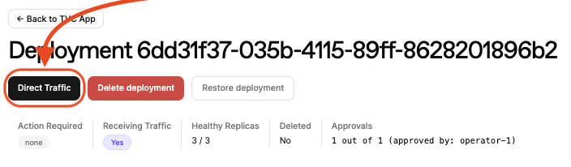
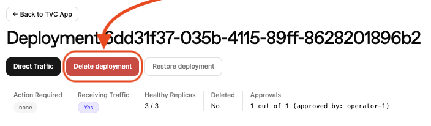
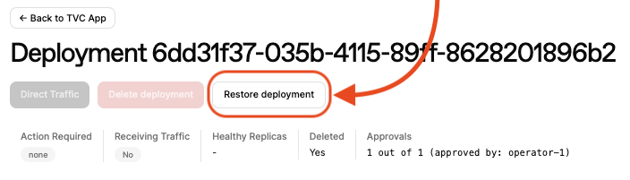

This guide covers how to direct traffic to a specific deployment, delete a deployment or app, restore a deleted deployment, and scope policies to a specific app.

For creating and approving your first deployment, see the [TVC quickstart](/features/verifiable-cloud/quickstart).

## Direct traffic to a deployment

Each TVC app has one live deployment at a time. To switch traffic to a different deployment, use the dashboard or the CLI.

**Dashboard**: Click into your deployment on the [TVC dashboard](https://app.turnkey.com/dashboard/v2/tvc) and click **Direct Traffic**, then confirm with **Make live**.

<Frame>
  
</Frame>

**CLI**:

```
tvc app set-live-deploy --deploy-id <DEPLOYMENT_UUID>
```

On success:

```
Set-live-deploy accepted.

Deployment ID: <DEPLOYMENT_UUID>
Activity ID: <ACTIVITY_UUID>
Activity Status: Active
```

## Delete a deployment

Deleting a deployment tears down its deployed resources so that the enclave instances are stopped and cleaned up. The deployment record remains visible in the dashboard.

**Dashboard**: Click into your app, find the deployment, and click **Delete deployment**.

<Frame>
  
</Frame>

**CLI**:

```
tvc deploy delete --deploy-id <DEPLOYMENT_UUID>
```

On success:

```
Deployment delete accepted; deployment is marked for deletion.

Deployment ID: <DEPLOYMENT_UUID>
Activity ID: <ACTIVITY_UUID>
Activity Status: Active
```

## Delete an app

Deleting an app tears down all of its child deployments. As with deployment deletion, the resources are cleaned up but the records remain visible.

**Dashboard**: Click into your app on the [TVC dashboard](https://app.turnkey.com/dashboard/v2/tvc) and click **Delete app**.

**CLI**:

```
tvc app delete --app-id <APP_UUID>
```

On success:

```
App delete accepted.
App and deployments marked for deletion.

App ID: <APP_UUID>
Activity ID: <ACTIVITY_UUID>
Activity Status: Active
```

## Restore a deployment

A deployment marked for deletion can be restored before its resources are fully cleaned up.

**Dashboard**: Click into your app, find the deployment, and click **Restore deployment**.

<Frame>
  
</Frame>

**CLI**:

```
tvc deploy restore --deploy-id <DEPLOYMENT_UUID>
```

On success:

```
Deployment restore accepted; deployment is no longer marked for deletion.

Deployment ID: <DEPLOYMENT_UUID>
Activity ID: <ACTIVITY_UUID>
Activity Status: Completed
```

## Scope policies to a specific app

TVC activities are governed by your organization's [policies](/features/policies/overview). To write a policy that applies to one app, match its ID with `activity.params.tvc_app_id`. This lets a single organization hold production and non-production apps under different rules: for example, a permissive policy for a staging app, while the production app stays behind stricter policies or consensus.

```json
{
  "policyName": "Allow deployments to the staging app",
  "effect": "EFFECT_ALLOW",
  "consensus": "approvers.any(user, user.id == '<USER_ID>')",
  "condition": "activity.kind in ['CREATE_TVC_DEPLOYMENT', 'DELETE_TVC_APP_AND_DEPLOYMENTS'] && activity.params.tvc_app_id == '<STAGING_APP_UUID>'"
}
```

`tvc_app_id` is available for two activity types only: `ACTIVITY_TYPE_CREATE_TVC_DEPLOYMENT` and `ACTIVITY_TYPE_DELETE_TVC_APP_AND_DEPLOYMENTS`. Activities that act on a deployment or a manifest, such as directing traffic, deleting or restoring a deployment, and approving a manifest, do not expose the app ID, so a policy cannot scope them to one app. If you need full separation between environments today, use a separate organization for each.

See the [policy language reference](/features/policies/language#activity-parameters) for all activity parameters.
