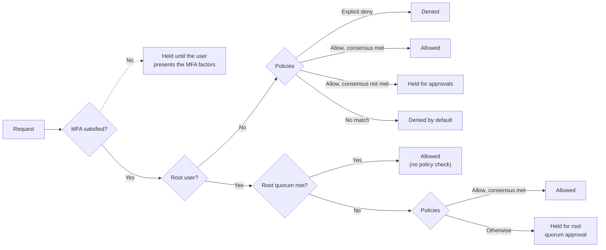

Turnkey keeps private keys inside [secure enclaves](/security/secure-enclaves) and checks every request against your root quorum, policies, and MFA requirements before anything is signed. What an attacker can do with your organization therefore comes down to one question: **what signing does your organization's configuration allow, and what has to be true before it happens?** Answering that is your side of the [shared responsibility model](/security/shared-responsibility-model).

Many large thefts have not required breaking any cryptography. They came from how keys were protected and how transactions were approved: a backend that could both request and approve its own transfers, signers persuaded to approve something they could not read, a single credential with full control. Some drained several wallets across several chains within minutes, faster than any alert could be acted on, which is why the controls that matter most are the ones enforced before a signature exists. This page covers each of those failures: what Turnkey enforces, and what you can configure.

<Note>
  The [production checklist](/get-started/production-checklist) is the short list to work through before launch. This page explains the reasoning behind the security items on it, and goes further for organizations that move significant value.
</Note>

## Policies, root quorum, and MFA

Turnkey decides whether a request goes ahead using three controls. They answer different questions, and most of this page is about choosing the right ones for each kind of user.

| Control | What it decides | Who it binds | Use it for |
|---|---|---|---|
| [Policies](/features/policies/overview) | With `condition` and `effect`: whether a user may do something at all, such as which activities, wallets, destinations, and amounts.<br />With `consensus`: which users, or how many, have to approve. | Non-root users.<br />Root users only where an allow policy explicitly covers them. | Defining what each service, agent, and team member may do, and requiring more than one person for sensitive actions |
| [Root quorum](/features/users/root-quorum) | How many root users have to approve | Root users acting together. It overrides policies. | The people who ultimately control the organization |
| [MFA policies](/features/authentication/mfa/overview) | Whether the same user has to present another factor | Every user, including root | Mainly end users in sub-organizations |

In short: policies say what users may do and who has to approve it. The root quorum lets root users, acting together, do anything without a policy. MFA asks the same person for more proof.

A few things about how they fit together:

- **Policies deny by default.** A non-root user can do nothing that a policy does not allow, apart from a few built-in permissions such as reading data and managing their own credentials. If one policy allows an activity and another explicitly denies it, the deny wins.
- **One policy can both allow and require approvals.** Its `condition` says what is allowed, and its `consensus` says who has to approve it. There is no separate kind of approval policy.
- **The root quorum sits above policies, but with a threshold above one, a single root user does not.** Once enough root users approve, Turnkey does not evaluate policies at all. With a threshold of one, a single root user is the whole quorum. With a higher threshold, a root user acting alone normally waits for the rest of the quorum. The exception is a matching allow policy: one with no `consensus` requirement lets that root user perform the activity alone, without the other root users. See [Using root users with policies](/features/users/root-quorum#using-root-users-with-policies).
- **MFA applies to every approver.** When a policy asks for two approvers, each of them is still held to their own MFA policies.

Put together, Turnkey decides each request in this order:



A held request is evaluated again each time someone approves it, whether with an MFA factor or as an additional approver, until it is allowed or rejected. Some actions are allowed without any policy, such as reading data in your own organization and managing your own credentials. [Policy evaluation](/features/policies/overview#policy-evaluation) covers these rules in detail.

Which controls apply depends on who is acting, and in particular on whether they are a root user. Where they sit depends on your design. Company wallets for treasury or payments can run entirely in the parent organization. Embedded wallets usually give each end user a sub-organization of their own, and services and agents can act in either place, for example as a [delegated access](/features/policies/delegated-access/overview) user inside an end user's sub-organization. Whatever the structure:

- **Your team in the parent organization.** Root quorum members are protected by the threshold itself, together with passkeys. Team members outside the root quorum act under policies, with consensus on anything sensitive. See [Protect the people in your parent organization](#protect-the-people-in-your-parent-organization).
- **Your services and agents, in any organization.** They should be non-root users acting under narrow allow policies, and anything large needs approval from people whose credentials are not on the same system. See [If your backend is compromised](#if-your-backend-is-compromised).
- **Your end users, if they have their own sub-organizations.** An end user is then usually the only root user of their sub-organization, with a threshold of one, so they are the whole quorum and policies do not constrain them. MFA policies do. See [Require MFA for your end users](#require-mfa-for-your-end-users).

## The root quorum is not bound by policies

The [root quorum](/features/users/root-quorum) can execute any action and bypasses the policy engine entirely. Once the root threshold is met, Turnkey allows the request without evaluating your policies, so even an `EFFECT_DENY` policy does not stop it. This is deliberate, since it is how an organization recovers from policies that lock it out, but it means the root quorum is effectively a master key.

- **Raise the root threshold above one.** With a threshold of one, any single root credential can do anything in your organization, regardless of the policies you have written. The production checklist recommends at least three members with a threshold of at least two.
- **Keep root credentials off servers.** Root quorum members should be people signing in with passkeys. Avoid giving a root user an API key that lives in a backend or a CI system.
- **Use non-root users for everything routine.** Anything you intend to constrain with a policy should be done by a non-root user, because once the root threshold is met, policies no longer apply.
- **Check which allow policies match root users.** Policies do apply to a root user acting alone, so an allow policy with no `consensus` requirement that matches a root user lets them do that activity without the other root users. A broad allow written with non-root users in mind can quietly turn a threshold of two into a threshold of one for that activity. Scope allow policies to the users or tags you intend, and grant a root user solo permissions only deliberately.

## Protect the people in your parent organization

Your parent organization is your Turnkey account: the organization your team signs in to, as opposed to any sub-organizations you create, for example one per end user. [MFA policies](#require-mfa-for-your-end-users) are mainly a tool for your end users. For the people in your parent organization, including root quorum members and anyone who approves transactions or policy changes, the protection comes from strong credentials and from requiring more than one person:

- **Use passkeys.** A passkey can live on a phone or laptop, or on a hardware security key such as a YubiKey. Either way it is bound to the site that registered it, so a phishing site cannot reuse it, and it cannot be read out over the phone the way a one-time code can.
- **Register at least two authenticators per person**, ideally of different types, such as a passkey on a laptop and one on a hardware security key, so that a lost device does not lock a quorum member out.
- **Keep admin credentials away from untrusted code.** Many attacks start on engineers' laptops, through tampered developer tools and "take-home assignments" from fake job interviews. A passkey does not help once malware is running inside a signed-in session. Root quorum members and other administrators are better off using a separate device, or at least a separate browser profile, for Turnkey than the one they use to install tools and run other people's code.
- **Make sensitive actions need more than one person.** A root threshold of two or more, and [consensus policies](/features/users/best-practices) for non-root users, mean one compromised person, or one compromised laptop, cannot act alone.

## If an approver is deceived

The credentials above stop an attacker from approving in someone else's name. They do not stop a real approver from approving the wrong thing.

- **Approve only what you can read.** Turnkey evaluates a request when it is signed, against the policies in force at that moment. It cannot judge whether a transaction is what the approver believes it is. Approvers should see the decoded destination, amount, and contract call before approving.
- **Avoid pre-signing.** Turnkey's signing activities return a signature without broadcasting anything, and whoever holds that signature can submit the transaction at any time. On Solana, a durable nonce keeps it valid indefinitely. A transaction signed in advance, for someone else to submit later, can therefore land in a context the approvers never saw. Where you can, sign and broadcast in one step with [transaction management](#send-transactions-through-turnkey).

## Require MFA for your end users

Most account takeovers start with one compromised credential: a session put to use by malicious script injected into your site or by malware on a user's device, a one-time code read out to a phisher. [MFA policies](/features/authentication/mfa/overview) make that one credential insufficient. When an activity matches the policy's condition, Turnkey holds it until the user also proves possession of a second, independent credential, such as a passkey on their device.

This section applies if your end users have sub-organizations of their own. Each is then usually the only root user of their sub-organization, with a threshold of one, so organization policies do not constrain them. MFA policies do: they apply to root users, and they are checked even when a policy would allow the activity. That makes them the strongest control you can put in front of an end user's wallet. Use them wherever your product allows, alongside [session profiles](/features/authentication/sessions/session-profiles), which limit what a given session can do.

**What to cover.** At a minimum, require MFA for:

- Signing, either all of it or above a value you choose.
- Exports of wallets and private keys.
- Changes to the user's credentials and to MFA policies themselves (see below).

For example, this policy asks for a passkey on top of the user's session for signing, exports, and credential or MFA changes:

```ts
// Illustrative example only. For maintained examples, see
// https://docs.turnkey.com/features/authentication/mfa/examples
mfaPolicy: {
  userId: "<END_USER_ID>",
  mfaPolicyName: "Passkey for signing, exports, and credential changes",
  condition: "activity.action == 'SIGN' || activity.action == 'EXPORT' || activity.resource == 'CREDENTIAL' || activity.resource == 'MFA_POLICY'",
  requiredAuthenticationMethods: [
    { any: [{ type: "AUTHENTICATION_TYPE_SESSION" }] },
    { any: [{ type: "AUTHENTICATION_TYPE_PASSKEY" }] },
  ],
  order: 0,
}
```

<Note>
  Treat this as a starting point, not something to paste into production. Before you enforce it, check that every user can satisfy it and that your recovery flow still works.
</Note>

Turnkey rejects an MFA policy the user cannot satisfy, so require factors the user actually has. See [MFA examples](/features/authentication/mfa/examples) for other designs, such as stronger factors for exports or asking again after a time window.

**What to watch for:**

- **MFA is set per user.** There is no organization-wide switch. Each MFA policy is created for one user, with its own activity, after that user exists. Turning MFA on means creating a policy for every user who should have one.
- **Cover changes to MFA and credentials.** By default, users can add and remove their own credentials and MFA policies. MFA can cover those actions too, but only if your condition includes them. If it covers only signing, a compromised session can register the attacker's own passkey, or delete the MFA policy, and then sign. Include `activity.resource == 'CREDENTIAL'` and `activity.resource == 'MFA_POLICY'` in the condition, as the example above does.
- **MFA is evaluated for the user who stamped the request.** If your backend submits logins for end users with its own API key, the end user's MFA policies are never consulted. See [MFA is evaluated for the user who stamped](/features/authentication/mfa/overview#mfa-is-evaluated-for-the-user-who-stamped) before relying on MFA at login.
- **Plan for lost factors before you enforce.** A user who loses their only passkey cannot satisfy a passkey requirement. Register a second factor at signup, and choose a recovery design from [MFA enforcement and recovery](/features/authentication/mfa/enforcement-and-recovery).

## Account recovery is a way in

Every way a user can regain access is also a way an attacker can gain it, so an account is only as strong as its weakest recovery path. Recovery does not reset a password. It attaches a new credential that can then do everything the old one could.

**For your end users**, [MFA enforcement and recovery](/features/authentication/mfa/enforcement-and-recovery) covers recovery designs in depth. The practices that matter most:

- **Make recovery at least as strong as sign-in.** Whatever methods you support, such as email, SMS, social logins, passkeys, or wallets, avoid letting any single one complete recovery on its own. Email inboxes and social accounts get taken over, and phone numbers get moved by SIM swaps. Require two independent factors, and check that they really are independent: an email address and a social login backed by the same Google account count as one.
- **Land recovery in a session that can only add a new authenticator**, using a [session profile](/features/authentication/sessions/session-profiles), so that even a successful attack on recovery cannot move funds directly.
- **Treat recovery as a security event.** Notify the user on every channel when a credential is added, give them a fast way to report it, and consider holding withdrawals for a day or more after recovery.

**Your own systems are recovery paths too:**

- **Your backend.** If your backend can add credentials to end users' sub-organizations, for example through a [delegated access](/features/policies/delegated-access/overview) user, then whoever compromises your backend can take over any user. Limit that user to what your recovery flow needs, and make the flow depend on something the end user proves, not only on your backend's decision.
- **Your support team.** Attackers impersonate users to get credentials added on their behalf. Support should not add or reset credentials because a ticket asks for it. Route recovery through the factors the user already has.

**For your parent organization**, Turnkey has no write access to your organization and cannot restore access. Recovering a root quorum member's access means the remaining members approving a change, which is only possible while enough of them can still sign. Rotate the quorum before people leave, test credentials regularly, and consider keeping one credential in institutional custody, as the [production checklist](/get-started/production-checklist#security) describes. When you invite a replacement, confirm in person or over a trusted channel that the right person accepted the invitation before granting permissions.

## If an API key leaks

An API key carries the full permissions of the user it belongs to. Assume that any key stored on a server will eventually leak, and limit what it can do when it does.

- **Give every application, service, and agent its own non-root, API-only user**, with only the permissions that service needs. A leaked key then exposes one service's permissions, and you can delete that key without affecting anything else. See [Users best practices](/features/users/best-practices#protecting-api-keys).
- **Restrict where keys can be used from.** An [IP allowlist](/features/ip-allowlisting/overview) limits requests to known networks, either for the whole organization or for a specific key. It applies to the parent organization only; requests to sub-organizations are not checked against it.
- **Use short-lived keys where you can.** A policy can [deny API keys that expire after more than seven days](/features/policies/examples/access-control#deny-creation-of-api-keys-that-expire-after-more-than-seven-days). An expiring key cannot be a user's only credential, though: every user needs at least one long-lived credential, such as a non-expiring API key or a passkey. Keep that long-lived credential away from the system that uses the short-lived keys, so that compromising the system does not expose it.
- **Keep keys out of source code and plain environment variables.** Store them in a secrets manager.
- **When a key leaks, deleting it is not the whole response.** There is no separate revoke step: you revoke a key by deleting it with [`DELETE_API_KEYS`](/api-reference/activities/delete-api-keys) and issuing a replacement. [Users can manage their own credentials](/features/organizations) unless a policy denies it or an MFA policy covers it, so whoever held the key may also have added another API key or authenticator to the same user. List that user's credentials and delete anything you did not create, or delete the user and recreate it.

## If your backend is compromised

Your backend probably runs its own checks before it asks Turnkey to sign: withdrawal limits, fraud rules, internal approvals. Those checks run on the same system an attacker would control. Once they are inside your backend, they can skip the checks and call Turnkey directly.

So put the limits that matter in Turnkey policies, where they are enforced before anything is signed, whatever your backend asks for. And for transfers above a threshold you choose, require approval from people whose credentials are not on that backend.

For example, use two policies with non-overlapping conditions: one lets the service sign small transfers alone, and one requires two human approvers for anything larger.

```json
// Illustrative example only. For maintained examples, see
// https://docs.turnkey.com/features/policies/examples/ethereum
{
  "policyName": "Service can sign transfers up to 1 ETH to approved destinations",
  "effect": "EFFECT_ALLOW",
  "consensus": "approvers.any(user, user.id == '<SERVICE_USER_ID>')",
  "condition": "activity.action == 'SIGN' && eth.tx.to in ['<ADDRESS_1>', '<ADDRESS_2>'] && eth.tx.value <= 1000000000000000000"
}
```

```json
// Illustrative example only. For maintained examples, see
// https://docs.turnkey.com/features/policies/examples/ethereum
{
  "policyName": "Transfers above 1 ETH need two approvers",
  "effect": "EFFECT_ALLOW",
  "consensus": "approvers.any(user, user.id == '<SERVICE_USER_ID>' || user.tags.contains('<APPROVER_TAG_ID>')) && (approvers.filter(user, user.tags.contains('<APPROVER_TAG_ID>')).count() >= 2)",
  "condition": "activity.action == 'SIGN' && eth.tx.to in ['<ADDRESS_1>', '<ADDRESS_2>'] && eth.tx.value > 1000000000000000000"
}
```

The service submits the transfer either way. Above the threshold, the activity waits in `ACTIVITY_STATUS_CONSENSUS_NEEDED` until two users with the approver tag approve it.

<Warning>
  Keep the conditions of these policies from overlapping. An `EFFECT_ALLOW` policy with no `consensus` requirement allows the request on its own, even when another matching policy asks for more approvers. A broad "the service can sign anything" policy would make the second policy above meaningless.
</Warning>

<Note>
  These policies only limit native ETH. An ERC-20 transfer is sent to the token contract, so it is allowed only if you add that contract to the list, and then its recipient and amount, which are in the calldata, are not checked. Treat example policies as a starting point, not something to paste into production, and test them against the transactions you actually send. See [Policies for wallets that move money](#policies-for-wallets-that-move-money) and the [Ethereum policy examples](/features/policies/examples/ethereum).
</Note>

Where human approval is not practical, you can split the service's own approval across two systems instead. A service user can hold two API keys, and an [MFA policy](/features/authentication/mfa/overview) on that user can require both by their IDs, so that each key has to [approve the activity](/features/authentication/mfa/satisfying-mfa#api-key). This helps only if the two keys live in separate systems. If both sit on the same backend, compromising it gets both. For an independent approver that runs your own checks, see [Add your own checks with Turnkey Verifiable Cloud](#add-your-own-checks-with-turnkey-verifiable-cloud).

## Send transactions through Turnkey

How you sign decides what your policies can check. A full transaction signed with `SIGN_TRANSACTION` can be parsed and checked; a hash or other raw payload cannot. With [transaction management](/features/transaction-management), Turnkey goes further: it builds, signs, and broadcasts the transaction for you through `ETH_SEND_TRANSACTION` and `SOL_SEND_TRANSACTION`, with optional gas sponsorship. Besides removing gas and nonce handling from your code, that has security benefits:

- **Policies see every call, even when sponsored or batched.** `eth.tx` and `solana.tx` describe your call: its destination, value, and calldata, with `eth.tx.from` set to your wallet even when a paymaster relays a sponsored transaction. In an EVM batch, each call is evaluated on its own, and the batch is allowed only if every call is allowed.
- **You can close the raw-payload gap.** A user that sends all its transactions through transaction management has no need to sign them as raw payloads, so you can withhold that permission, or limit it to the message types it actually signs. Raw payload signing is the main way around transaction policies, whether through blind signing or a hidden [EIP-7702 authorization](#eip-7702-delegations).
- **Sponsorship without opaque signatures.** On EVM chains, gas sponsorship works through an EIP-7702 delegation to Turnkey's gas station delegate contract. You get gasless and batched transactions while the policy engine still sees every call, which is not the case for ERC-4337 user operations signed as hashes. It also keeps the set of delegations your wallets need small and known.
- **Spend is capped and visible.** [Gas spend limits](/features/transaction-management#spend-limits) cap sponsorship for the organization and for each sub-organization, and [`SEND_TRANSACTION_STATUS_UPDATES` webhooks](/features/webhooks/overview) report every transaction's progress, so unexpected outflows show up in your monitoring.

## Policies for wallets that move money

Policies are only as strong as what they can see. Every wallet that holds meaningful value should have policies covering approved destinations, value limits, and who has to approve large transfers. Sending through [transaction management](#send-transactions-through-turnkey) gives those policies the most to work with.

Write them with the following limits in mind.

- **Native value only covers native transfers.** `eth.tx.value` is the amount of ETH sent. An ERC-20 transfer has a value of zero, and its amount and recipient are inside the calldata. To limit token transfers, upload a [smart contract interface](/features/policies/smart-contract-interfaces) and write conditions on the parsed arguments. Where no ABI is available, you can match on slices of the raw calldata in `eth.tx.data`, such as the function selector. See the [Ethereum policy examples](/features/policies/examples/ethereum) for both.
- **Limits apply per transaction, not per day.** A per-transaction limit does not bound how much leaves a wallet over a day, because many transactions under the limit are each allowed. Size your limits with that in mind, and keep the human-approval threshold low enough that repeated small transfers are noticed (see [Detect and respond](#detect-and-respond)).
- **Raw payload signing skips transaction parsing.** A transaction can be signed as a raw payload, and Turnkey cannot apply transaction conditions such as `eth.tx.to` to it. If a user is meant to sign transactions under an allowlist, avoid also allowing that user to sign raw payloads, send its transactions through [transaction management](#send-transactions-through-turnkey) so it has no need to, or restrict raw payload signing to typed data your policies can inspect, such as [EIP-712 messages](/features/policies/examples/ethereum#inspect-nested-fields-in-eip-712-message-payloads).
- **Not every chain is parsed.** The policy engine parses Ethereum and other EVM chains, Solana, Tron, Bitcoin, and Tempo transactions. On other chains, signing is a raw payload, and conditions on destination or amount cannot apply. For hot wallets on those chains, consider requiring human approval for every signature, keeping balances low, or adding your own parsing with a [TVC policy sidecar](#add-your-own-checks-with-turnkey-verifiable-cloud).
- **ERC-4337 user operations are signed as raw hashes.** Policies cannot see their sender, target, or calldata. If you need sponsored or batched transactions with policy coverage, see [Send transactions through Turnkey](#send-transactions-through-turnkey). If you use ERC-4337, the controls on those wallets have to come from somewhere other than transaction conditions.
- **Exported keys are outside Turnkey's control.** Once a wallet or private key is exported, nothing signed with it elsewhere is checked against your policies. Treat permission to export like root permission, and use policies to [restrict which accounts can be exported](/features/policies/examples/access-control#allow-exporting-only-a-specific-wallet-account-address).
- **Client-side signing is an export.** With [client-side signing](/sdks/advanced/client-side-signing), a key is exported to the user's browser so it can sign locally. Following our recommended setup, it is exported into an iframe using the [iframe stamper](/sdks/advanced/iframe-stamper), which keeps the key out of your page's JavaScript. Handling an exported key any other way, such as decrypting it in your own page, removes that protection. Even in the iframe, any script running in your page, whether an XSS bug, a malicious extension, or a drainer bookmarklet, can still ask it to sign, and nothing it signs is checked by policies or MFA. The bigger risk is the session that loads the keys: whoever can use it can export the keys themselves, and unlike a session, an exported key cannot be revoked. If you use it:
  - Issue sessions from a [session profile](/features/authentication/sessions/session-profiles) that cannot export or add credentials, so loading keys into the iframe requires a passkey.
  - Export only a dedicated wallet holding what you would accept losing, keep the rest in wallets that are never exported, and limit what the session can sign from them.
  - Load only the keys you need, [clear them](/sdks/advanced/client-side-signing#clearing-keys) when you are done, and lock your page down with a strict Content Security Policy.
- **Protect the policies themselves.** Anyone who can change a policy can remove the limits above. [Require multiple approvers for policy changes](/features/policies/examples/access-control#require-two-users-with-a-specific-tag-to-add-policies), and do the same for creating users and adding credentials to other users.

## Add your own checks with Turnkey Verifiable Cloud

Some rules cannot be written as policies, or depend on data Turnkey does not have. With [Turnkey Verifiable Cloud](/features/verifiable-cloud/overview) (TVC, currently in private beta), you can run them as a [policy sidecar](/solutions/verifiable-cloud/custom-policy-enforcement): your own service, running in a Turnkey secure enclave, that receives activity webhooks, checks each request against your rules, and approves or rejects it as a separate service user. Require its approval in a policy's `consensus`, and the activities that policy covers cannot complete without it.

Because the sidecar runs in an enclave rather than on your backend, it addresses several of the gaps on this page:

- **An approver your backend cannot impersonate.** Its credential exists only inside the enclave, and a new version of its code goes live only after the deployment approvals you require. Compromising your backend gives an attacker neither.
- **Checks beyond native parsing.** It can parse transactions on chains Turnkey does not parse natively, and apply recipient and amount limits to them.
- **Checks that need outside data,** such as address screening, or value limits based on oracle prices.
- **Rules about administrative changes,** such as who may create policies.

As with any consensus requirement, review your other allow policies and the root quorum, which can authorize a request without the sidecar.

## EIP-7702 delegations

Malicious EIP-7702 authorizations are now a common way to drain EVM wallets, both in attacks on companies and in phishing aimed at individual users. An [EIP-7702](/features/policies/language#eip-7702) authorization lets a smart contract act on behalf of a wallet. Once signed, it stays in force onchain until the account signs a new one, so an attacker who gets a single authorization signed can keep moving funds long after you have revoked their access or shut down your own systems.

Make signing an authorization a deliberate decision rather than something any key can do:

- **For your own wallets,** use policies to limit authorizations to the delegate contracts and chains you actually use. The policy engine can inspect EIP-7702 authorizations, and the [Ethereum policy examples](/features/policies/examples/ethereum#allow-signing-of-eip-7702-authorizations) show how. An authorization with `chain_id` 0 is valid on every EVM chain, so be especially wary of those.
- **For end users with their own sub-organizations,** remember that policies do not bind them, since they are usually the only root user of their sub-organization. If your product lets users sign arbitrary payloads, for example on behalf of connected apps, a malicious site can ask for an authorization. Consider whether your product needs to offer that at all, show users clearly what they are authorizing, and use [session profiles](/features/authentication/sessions/session-profiles) to narrow what a session can sign.
- **Raw payloads can hide authorizations.** A payload signed as hexadecimal or UTF-8 can also be an authorization, so conditions on the EIP-7702 encoding alone do not cover every case. See the notes in the [Ethereum policy examples](/features/policies/examples/ethereum#deny-batch-signing-of-eip-7702-authorizations).
- **Know how to undo one.** An EIP-7702 delegation stays active until the account is undelegated, which Turnkey supports as a single [undelegate activity](/api-reference/activities/undelegate-an-evm-account). See [Detect and respond](#detect-and-respond).

## AI agents

An agent that can sign is a user like any other, and should be constrained the same way.

- **Give each agent its own non-root user.** Avoid letting an agent act with a person's credentials or session.
- **Put the agent's limits in Turnkey policies.** Limits written in the agent's prompt or its own code can be talked around. Policies are evaluated in the enclave before anything is signed, whatever the agent was told. For rules a policy cannot express, a [TVC policy sidecar](#add-your-own-checks-with-turnkey-verifiable-cloud) can approve or reject the agent's requests with checks of your own.
- See [Agentic wallets](/features/policies/delegated-access/agentic-wallets) and [Delegated access](/features/policies/delegated-access/overview) for patterns.

## Detect and respond

Prevention reduces what an attacker can do. Detection decides how long they have to do it.

- **Subscribe to activity webhooks.** [`ACTIVITY_UPDATES` webhooks](/features/webhooks/overview) deliver signed notifications for every activity. Alert on the activities that change who controls your organization or its funds: root quorum updates, policy changes, new users, new API keys or authenticators, exports, and EIP-7702 authorizations.
- **Alert on new root credentials.** A credential an attacker adds to a root user can do anything in that organization, and with a threshold of one, as in most end-user sub-organizations, it needs no one else's approval. Consider alerting on `CREATE_AUTHENTICATORS`, `CREATE_API_KEYS`, and `CREATE_OAUTH_PROVIDERS` activities whose target user is one of your root users, and on changes to a user's email address or phone number, since those are sign-in and recovery paths too. Webhooks on your parent organization include activities in its sub-organizations, so one subscription covers your end users. An alert fires after the credential exists. To stop it from being added in the first place, [require MFA](#require-mfa-for-your-end-users) for `activity.resource == 'CREDENTIAL'`.
- **Log who approved what.** Record activity IDs and the credentials that approved them, as described in the [production checklist](/get-started/production-checklist#logging), so that you can reconstruct an incident.
- **Review access regularly.** Remove users, keys, and policies that are no longer used, and check that every root quorum member can still sign in.
- **Decide your response in advance.** Know who can delete a compromised user or key, and confirm they can do it quickly. If only the root quorum can, under a threshold of two that means reaching two people. Deleting a service's API keys is usually the fastest way to stop it. Adding a deny policy can be slower if policy changes need several approvals, and it does not bind the root quorum.
- **Plan for what keeps working after you stop.** Shutting down your own systems does not undo what was already signed. A transaction that was signed and broadcast stays valid until it is mined or replaced with another transaction using the same nonce. An EIP-7702 delegation stays active until the account is undelegated, which Turnkey supports as a single [undelegate activity](/api-reference/activities/undelegate-an-evm-account). Make sure the people in your incident plan are allowed to run it, and try it once before you need it.
- **Rehearse your response.** Run tabletop exercises that walk through an incident end to end, such as a leaked API key or a phished approver. They show where your plan and reality differ, such as a missing permission or an approver who cannot be reached, before you find out during a real incident.
