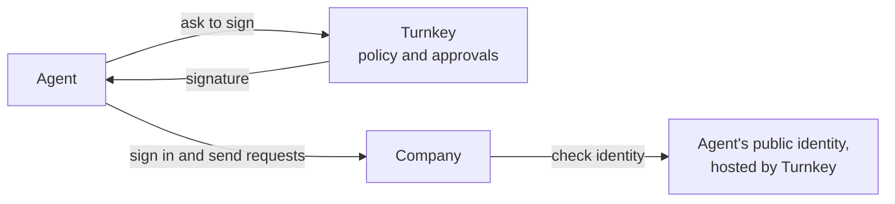

import { FeatureCard } from '/snippets/feature-card.mdx'
import { SolutionCard } from '/snippets/solution-card.mdx'
import { MintJwtCallout } from '/snippets/mint-jwt-callout.mdx'

<MintJwtCallout />

A personal agent books, buys, and signs in at companies for the people who use it. Each company needs to know which agent is calling, so the agent proves who it is with one key. Whoever holds that key is the agent, for every user and every company at once. If the key sits on the agent's servers, one breach lets an attacker become the agent.

With Turnkey, the agent never holds that key. It asks Turnkey to sign for it, your policies decide what Turnkey signs, a person can be required to approve, and every signature is recorded.

[Personal Agent Protocol](https://personalagentprotocol.org) (PAP) is the open standard from Sierra and Meta for agents that act for a user at a company.

## Why Turnkey for Personal Agent Protocol?

- **No key to steal**: the agent's identity key stays in Turnkey's [secure enclaves](/security/secure-enclaves). The agent's servers never see it, so a breach there doesn't hand over the agent.
- **Your rules on every signature**: [policies](/features/policies/overview) decide which companies the agent may sign in to, and how long each signature stays valid.
- **A person in the loop**: a policy can require someone to approve before Turnkey signs, for example with a passkey on their phone.
- **A record of every signature**: each signature is a Turnkey activity, so you can see what the agent signed, when, and who approved it. Deleting a policy stops new signatures at once.

## How it works



1. You register the agent and create its identity key in Turnkey. Turnkey publishes the public half at a URL that companies check.
2. To sign in at a company, or to keep its access fresh, the agent asks Turnkey to sign a short-lived proof of who it is, called a client assertion.
3. For everyday requests, the agent makes its own short-lived session key and asks Turnkey to vouch for it, with a delegation. The agent then signs requests itself, without a call to Turnkey each time.
4. Turnkey checks each signing request against your policies, waits for any approvals they require, signs, and records it.
5. The company checks what the agent sends against the agent's published identity.

The rest of this page sets up an agent, then walks through how it signs in at a company.

## Set up an agent

<Steps>
  <Step title="Register the agent">
    Register the agent with Turnkey under your organization and a slug, such as `shopper`. Its `client_id` is its [hosted](#hosted-agent-identity) `agent.json` URL, such as `https://id.turnkey.com/t/<organization ID>/agents/shopper/agent.json`.
  </Step>
  <Step title="Create a sub-organization for the agent">
    Give each agent its own [sub-organization](/features/sub-organizations). Its [root user](/features/users/root-quorum) is an administrator that holds your API key. Root users skip policy, so the agent must not be one.
  </Step>
  <Step title="Add a non-root agent user">
    Create a user with its own API key, and give it no other permissions. Policy applies to this user, so the policies below are all it can do.
  </Step>
  <Step title="Create the identity key">
    Create a P-256 private key in the sub-organization, with `curve: "CURVE_P256"` and `addressFormats: ["ADDRESS_FORMAT_UNCOMPRESSED"]`. This is the key Turnkey publishes in the agent's `jwks_uri`.
  </Step>
  <Step title="Write the policies">
    Write one ALLOW policy per profile for the agent user, and a DENY that keeps the key from signing any other way.
  </Step>
</Steps>

### Allow client assertions

This policy lets the agent user sign in to one company, for at most 60 seconds per assertion, with the identity key:

```json
{
  "policyName": "PAP agent can sign in to auth.example.com",
  "effect": "EFFECT_ALLOW",
  "consensus": "approvers.any(user, user.id == '<AGENT_USER_ID>')",
  "condition": "activity.type == 'ACTIVITY_TYPE_MINT_JWT' &&
    activity.params.profile == 'JWT_PROFILE_CLIENT_ASSERTION_V1' &&
    activity.params.audience == 'https://auth.example.com' &&
    activity.params.client_assertion_v1.client_id == '<CLIENT_ID>' &&
    activity.params.client_assertion_v1.time_to_live_seconds <= 60 &&
    private_key.id == '<IDENTITY_KEY_ID>'"
}
```

Write one such policy per company, or drop the `audience` clause to allow any company.

### Allow delegations

This policy lets the agent user mint delegations that last at most two hours:

```json
{
  "policyName": "PAP agent can mint delegations",
  "effect": "EFFECT_ALLOW",
  "consensus": "approvers.any(user, user.id == '<AGENT_USER_ID>')",
  "condition": "activity.type == 'ACTIVITY_TYPE_MINT_JWT' &&
    activity.params.profile == 'JWT_PROFILE_POPPY_DELEGATION_V1' &&
    activity.params.poppy_delegation_v1.client_id == '<CLIENT_ID>' &&
    activity.params.poppy_delegation_v1.time_to_live_seconds <= 7200 &&
    private_key.id == '<IDENTITY_KEY_ID>'"
}
```

`time_to_live_seconds` is a number in both profiles, so compare it with `<=`, not with a string. For both profiles, `private_key` is the `signWith` key, so `private_key.id` and `private_key.tags` work. `activity.params.poppy_delegation_v1.delegated_key_thumbprint` is the [RFC 7638](https://www.rfc-editor.org/rfc/rfc7638) thumbprint of the delegated key, if you want to allow only known keys.

To have a person approve each mint as well, require a second approver in `consensus`, such as the user's passkey user:

```json
"consensus": "approvers.any(user, user.id == '<AGENT_USER_ID>') && approvers.any(user, user.id == '<OWNER_USER_ID>')"
```

### Make the profiles the only way to sign

A user who can raw-sign with the identity key can sign any claims, with another `aud`, a longer `exp`, or a reused `jti`, and get around every limit above. This DENY closes that path, so the key signs only through the two profiles and your ALLOW policies decide every signature:

```json
{
  "policyName": "PAP identity key signs only through Mint JWT",
  "effect": "EFFECT_DENY",
  "condition": "activity.type in ['ACTIVITY_TYPE_SIGN_RAW_PAYLOAD', 'ACTIVITY_TYPE_SIGN_RAW_PAYLOAD_V2', 'ACTIVITY_TYPE_SIGN_RAW_PAYLOADS', 'ACTIVITY_TYPE_SIGN_TRANSACTION', 'ACTIVITY_TYPE_SIGN_TRANSACTION_V2', 'ACTIVITY_TYPE_EXPORT_PRIVATE_KEY'] &&
    private_key.id == '<IDENTITY_KEY_ID>'"
}
```

Put `activity.type` first, so `private_key` is only read for activities that have one.

Policy sees a mint as resource `JWT` and action `MINT`, not `PRIVATE_KEY` and `SIGN`. A DENY written on `activity.action == 'SIGN'` or `activity.resource == 'PRIVATE_KEY'` doesn't stop the profiles. To stop the agent at once, delete its ALLOW policies with the administrator's key, or create a DENY that also names the two profiles:

```json
{
  "policyName": "PAP identity key is stopped",
  "effect": "EFFECT_DENY",
  "condition": "(activity.type in ['ACTIVITY_TYPE_SIGN_RAW_PAYLOAD', 'ACTIVITY_TYPE_SIGN_RAW_PAYLOAD_V2', 'ACTIVITY_TYPE_SIGN_RAW_PAYLOADS', 'ACTIVITY_TYPE_SIGN_TRANSACTION', 'ACTIVITY_TYPE_SIGN_TRANSACTION_V2', 'ACTIVITY_TYPE_EXPORT_PRIVATE_KEY'] ||
    (activity.type == 'ACTIVITY_TYPE_MINT_JWT' && activity.params.profile in ['JWT_PROFILE_CLIENT_ASSERTION_V1', 'JWT_PROFILE_POPPY_DELEGATION_V1'])) &&
    private_key.id == '<IDENTITY_KEY_ID>'"
}
```

The profile check keeps `private_key` from being read for other Mint JWT profiles, which have no key. Delete this DENY to start the agent again.

## Sign in at a company

At each company, the agent works through these steps. The identity key signs in steps 1 and 3. Everything else happens on the agent's side.

<Steps>
  <Step title="Mint a delegation for a fresh session key">
    Make a new P-256 key pair locally and mint a delegation for its public key. A delegation lasts at most 24 hours. One to two hours is better.
  </Step>
  <Step title="Sign Session JWTs locally">
    Sign the `Poppy-Session` header of each request with the session key, and send the delegation with it. The session key never goes to Turnkey.
  </Step>
  <Step title="Mint a client assertion to sign in or refresh">
    Mint a client assertion for the company's issuer and send it to the company's token endpoint, both to sign in and to refresh a token.
  </Step>
</Steps>

DPoP keys, which sign the proofs for DPoP-bound tokens, also stay local.

### Mint a delegation

The `JWT_PROFILE_POPPY_DELEGATION_V1` profile (`turnkey.io/poppy-delegation/v1`) signs a PAP delegation for a delegated P-256 public key:

```typescript
import { randomBytes, webcrypto } from "node:crypto";

// The session key stays on the agent's side.
const sessionKey = await webcrypto.subtle.generateKey(
  { name: "ECDSA", namedCurve: "P-256" },
  false,
  ["sign"],
);
const { x, y } = await webcrypto.subtle.exportKey("jwk", sessionKey.publicKey);

const { jwt: delegation } = await turnkey.apiClient().mintJwt({
  organizationId: agentSubOrganizationId,
  profile: "JWT_PROFILE_POPPY_DELEGATION_V1",
  poppyDelegationV1: {
    signWith: identityKeyId,
    clientId: "https://id.turnkey.com/t/<organization ID>/agents/shopper/agent.json",
    delegatedKeyX: x!,
    delegatedKeyY: y!,
    jti: randomBytes(16).toString("base64url"),
    timeToLiveSeconds: "3600",
    issuedAt: String(Math.floor(Date.now() / 1000)),
  },
});
```

| Field | Value |
| :--- | :--- |
| `signWith` | ID of a P-256 private key in the organization. Wallet accounts are not supported |
| `clientId` | The agent's `client_id`, an HTTPS URL of at most 512 characters. Becomes `iss` |
| `delegatedKeyX`, `delegatedKeyY` | The delegated P-256 public key's `x` and `y`, as in its JWK. Public members only. Must not be the `signWith` key. Becomes `cnf.jwk` |
| `jti` | 22 to 256 base64url characters, such as 16 random bytes. Becomes `jti` |
| `timeToLiveSeconds` | 1 to 86400 |
| `issuedAt` | Unix time in seconds. Becomes `iat` |

This profile has no `audience`: a delegation names no company and no user. The resulting JWT has this header and these claims, and nothing else:

```json
{ "alg": "ES256", "typ": "poppy-delegation+jwt", "kid": "<RFC 7638 thumbprint of the identity key>" }
.
{
  "iss": "https://id.turnkey.com/t/<organization ID>/agents/shopper/agent.json",
  "cnf": { "jwk": { "kty": "EC", "crv": "P-256", "x": "<x>", "y": "<y>" } },
  "iat": 1790900000,
  "exp": 1790903600,
  "jti": "Kp8mR3vT1nWc4AYx2b7Qd_"
}
```

### Mint a client assertion

The agent authenticates at a company's token endpoint with `private_key_jwt` ([RFC 7523](https://www.rfc-editor.org/rfc/rfc7523)). PAP requires `aud` to be the company's issuer, `exp` at most five minutes after `iat`, and a unique, unguessable `jti`. The `JWT_PROFILE_CLIENT_ASSERTION_V1` profile (`turnkey.io/client-assertion/v1`) signs it:

```typescript
import { randomBytes } from "node:crypto";

const { jwt: clientAssertion, signingKeyJwk } = await turnkey.apiClient().mintJwt({
  organizationId: agentSubOrganizationId,
  profile: "JWT_PROFILE_CLIENT_ASSERTION_V1",
  audience: "https://auth.example.com",
  clientAssertionV1: {
    signWith: identityKeyId,
    clientId: "https://id.turnkey.com/t/<organization ID>/agents/shopper/agent.json",
    jti: randomBytes(16).toString("base64url"),
    timeToLiveSeconds: "60",
    issuedAt: String(Math.floor(Date.now() / 1000)),
  },
});
```

| Field | Value |
| :--- | :--- |
| `audience` | The company's issuer, as `https://<lowercase host>[:port][/path]` with no query or fragment. Compared as given. Becomes `aud` |
| `signWith` | ID of a P-256 private key in the organization. Wallet accounts are not supported |
| `clientId` | The agent's `client_id`, an HTTPS URL of at most 512 characters. Becomes `iss` and `sub` |
| `jti` | 22 to 256 base64url characters, such as 16 random bytes. Becomes `jti` |
| `timeToLiveSeconds` | 1 to 300 |
| `issuedAt` | Unix time in seconds, within 24 hours of now. Becomes `iat` |

The resulting JWT has this header and these claims, and nothing else:

```json
{ "alg": "ES256", "typ": "JWT", "kid": "<RFC 7638 thumbprint of the identity key>" }
.
{
  "iss": "https://id.turnkey.com/t/<organization ID>/agents/shopper/agent.json",
  "sub": "https://id.turnkey.com/t/<organization ID>/agents/shopper/agent.json",
  "aud": "https://auth.example.com",
  "iat": 1790900000,
  "exp": 1790900060,
  "jti": "Kp8mR3vT1nWc4AYx2b7Qd_"
}
```

For both profiles, `signingKeyJwk` is the identity key's public JWK, and the same request always returns the same token, so a retried activity is safe.

## Hosted agent identity

A company fetches the agent's `client_id` without following redirects and checks that the document's `client_id` equals the URL it fetched. Turnkey serves both of the agent's documents, and the key it publishes is the same P-256 key the profiles sign with, so the key you hold in Turnkey is the key companies see.

| Method | Path | Returns |
| :--- | :--- | :--- |
| GET | `https://id.turnkey.com/t/<organization ID>/agents/<agent>/agent.json` | The agent's client ID metadata document |
| GET | `https://id.turnkey.com/t/<organization ID>/agents/<agent>/jwks.json` | The agent's public P-256 keys, its `jwks_uri` |

The organization ID is the parent organization, as in [Mint JWT](/features/mint-jwt#token-claims) issuers. `<agent>` is the agent's slug, 1 to 64 lowercase letters, digits, and hyphens. The agent's `client_id` is the `agent.json` URL itself. Pass that value as `clientId` in both profiles.

`agent.json` holds:

| Member | Value |
| :--- | :--- |
| `client_id` | The URL the document is served at |
| `client_name`, `logo_uri` | The agent's display name, and its logo when set |
| `jwks_uri` | The `jwks.json` URL next to it |
| `redirect_uris` | Empty for a headless agent. Otherwise loopback URIs (`http://127.0.0.1` or `http://[::1]`), or HTTPS URLs under the agent's own path on `id.turnkey.com` |
| `token_endpoint_auth_method` | `private_key_jwt` |
| `token_endpoint_auth_signing_alg` | `ES256` |

`jwks.json` lists each key with `kty`, `crv`, `x`, `y`, `kid` (the [RFC 7638](https://www.rfc-editor.org/rfc/rfc7638) thumbprint, the same `kid` the profiles put in the header), `use: sig`, and `alg: ES256`. It never has private members. Turnkey serves both documents with a five-minute cache lifetime, so a key rotation reaches companies quickly.

## Limits

- **Revoking the policy doesn't end delegations.** Deleting the ALLOW policies stops new signatures at once, so refreshes and new sign-ins stop. Delegations already signed keep working until they expire, up to 24 hours, and so do access tokens. Shorter delegations are better. PAP says a delegation can't be withdrawn. Removing the key from `jwks_uri` ends them once companies' cached copies of the key set expire.
- **No blind signing.** PAP section 10.7 says an agent should have its client assertions and delegations signed blindly, with RSA blind signatures, unless its own systems need to see which companies a user works with. Turnkey doesn't do RSA blind signing. It checks what it signs against your policies and records it, so the agent operator's records show which companies its users signed in to. PAP allows this for operators whose systems need to see that.
- **Root users skip policy.** The DENY policies stop the agent user, not the sub-organization's [root quorum](/features/users/root-quorum). Keep the identity key out of root-held automation.
- **Mediated Sign-In retires on 2027-03-17.** PAP retires the Mediated Sign-In extension on that date. Direct Sign-In is PAP's preferred sign-in.

## Next steps

<div style={{display: 'grid', gridTemplateColumns: 'repeat(2, 1fr)', gap: '12px'}}>
  <FeatureCard title="Mint JWT" icon="file-shield-02" href="/features/mint-jwt" description="JWTs signed after policy approval." />
  <FeatureCard title="Policy Engine" icon="file-shield-02" href="/features/policies/overview" description="Consensus expressions, conditions, and time windows." />
  <FeatureCard title="Sub-organizations" icon="dataflow-02" href="/features/sub-organizations" description="Give each agent its own organization and keys." />
  <SolutionCard title="Git signing and SSH" icon="api-key-storage" href="/solutions/key-management/git-signing" description="Sign Git commits and open SSH connections from agents, with keys that never leave Turnkey." />
</div>
