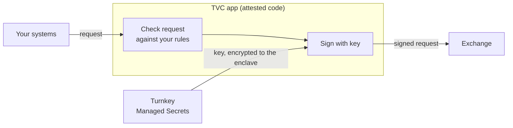

import { FeatureCard } from '/snippets/feature-card.mdx'
import { SolutionCard } from '/snippets/solution-card.mdx'

## Some secrets can't be rotated away

If an exchange API key with withdrawal rights leaks, the withdrawals it signed are final. If a code-signing or token-signing key leaks, its signatures stay valid. Rotation stops the next attack, but it doesn't undo the last one.

These keys usually sit in a secrets manager that hands plaintext to any caller with the right role. From there they end up in a trading bot, a CI runner, or a laptop.

With Turnkey Verifiable Cloud (TVC), once you import the key, it is only in plaintext inside an attested app that you control.

| Tier | Examples | Where it belongs |
| :--- | :--- | :--- |
| **Pivot** | Production database credentials, CI deploy tokens | [Managed Secrets](/features/secrets), released to one service under policy |
| **Root** | Cloud admin credentials, KMS master keys | Managed Secrets, with multi-party approval for every release |
| **Irreversible** | Exchange withdrawal keys, code-signing and token-signing keys | This page: used only inside a TVC app |

## How it works



1. Your system sends a request, such as a withdrawal, to the TVC app.
2. The app loads the key from Managed Secrets. Policy lets only this app export it, and the key is encrypted to the app's enclave.
3. The app checks the request against your rules, such as an address allowlist or an amount limit.
4. If the checks pass, the app signs the request and sends it to the exchange, or returns it to your proxy.

What you get:

- **Plaintext only in enclaves.** Your engineers, your cloud provider, and Turnkey see ciphertext.
- **No one acts alone.** A quorum of your administrators, such as 3 of 5, approves policy changes and every new version of the app.
- **Rules you can verify.** Your security team can confirm exactly which code holds the key, using [Boot Proofs](/features/verifiable-cloud/proofs-and-verification).
- **Fast.** The app can be configured to load the key once and keep it in memory, so signing needs no extra network call.

## Policy or app code?

| Control | Where it lives |
| :--- | :--- |
| Who can export the key, and break-glass approvals | Turnkey [policy](/features/policies/overview) |
| Per-request rules: allowlists, limits, price checks | TVC app code |
| Which app version runs | Your administrator quorum |

Only the TVC app can export venue keys:

```json
{
  "policyName": "Only the TVC signing app can export venue keys",
  "notes": "",
  "effect": "EFFECT_ALLOW",
  "consensus": "approvers.any(u, u.id == '<TVC_APP_USER_ID>')",
  "condition": "activity.type == 'ACTIVITY_TYPE_EXPORT_SECRETS' && secret.static_properties['kind'] == 'exchangeApiKey'"
}
```

## Networking

- **Direct.** The app calls the exchange itself, so the whole path stays in the enclave. Many exchanges require an IP allowlist for withdrawal keys, so ask us about egress IPs.
- **Your proxy.** The app returns the signed request, and your existing proxy and IP allowlists send it. The proxy never holds the key.

## Getting set up

<Steps>
  <Step title="Create your organization">
    Create a Turnkey organization and enroll your administrators with security keys.
  </Step>
  <Step title="Create the production app">
    Create a separate production app with a fresh Quorum Key and a custom share set. Set the manifest approvers and threshold at creation, such as 3 of 5. Follow the [worked example](/features/verifiable-cloud/manifest-sets-and-share-sets#worked-example) to create the key, deploy the app, and provision its shares.

    The [quickstart](/features/verifiable-cloud/quickstart) uses a well-known development Quorum Key. Do not use it for secrets. TVC does not support changing an app's manifest set or threshold after creation.
  </Step>
  <Step title="Register the app credential">
    Derive a dedicated P-256 API credential from the app's Quorum Key inside the enclave. Use the same derivation across replicas and approved deployments. Register only its public key on a non-root Turnkey user. Use that user's ID as `<TVC_APP_USER_ID>`. Keep the private key inside the enclave. Generate each export target key pair inside the enclave too.
  </Step>
  <Step title="Set the root quorum">
    Before importing production secrets, set the [root quorum](/features/users/root-quorum) to your production threshold, such as 3 of 5. This controls policy changes and break-glass access. The manifest threshold set at app creation controls deployment approvals.
  </Step>
  <Step title="Import the key">
    Import the venue key into [Managed Secrets](/features/secrets) with properties such as `kind: exchangeApiKey`. Then delete every other copy. Start with a testnet or low-limit key.
  </Step>
  <Step title="Scope export to the app">
    Add the policy above, using the dedicated app user's ID.
  </Step>
</Steps>

## Authorize calls to the app

Require every call to the app to carry a Turnkey-minted JWT, so Turnkey policy and your approvers decide who can use the key. See [JWT auth for TVC apps](/solutions/verifiable-cloud/jwt-http-auth).

## Non-custodial trading on behalf of customers

Order and execution management platforms hold one key per client and per venue. Each client gets their own [sub-organization](/features/sub-organizations) and imports their keys there, so the keys never pass through your systems. Clients can verify the code that uses their keys before they import them.

## Get started

Bring the key you can least afford to lose, and we will design the app and policies with you. [Contact us](https://www.turnkey.com/contact-us) to book an architecture session.

<div style={{display: 'grid', gridTemplateColumns: 'repeat(2, 1fr)', gap: '12px'}}>
  <SolutionCard title="Secrets manager replacement" icon="tvc" href="/solutions/verifiable-cloud/secrets-manager-replacement" description="Move every secret into enclave-enforced policy, tier by tier." />
  <SolutionCard title="JWT auth for TVC apps" icon="tvc" href="/solutions/verifiable-cloud/jwt-http-auth" description="Let Turnkey policy decide who can call your enclave app." />
  <SolutionCard title="API key storage" icon="api-key-storage" href="/solutions/key-management/api-key-storage" description="Release API keys to an authorized service under policy." />
  <FeatureCard title="Managed Secrets" icon="lock-01" href="/features/secrets" description="How secrets are stored and released." />
  <FeatureCard title="Turnkey Verifiable Cloud" icon="cpu-chip-01" href="/features/verifiable-cloud/overview" description="Deploy apps with verifiable code and secure keys." />
</div>
