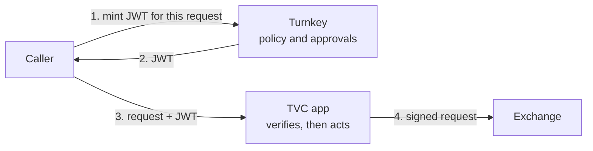

import { FeatureCard } from '/snippets/feature-card.mdx'
import { MintJwtCallout } from '/snippets/mint-jwt-callout.mdx'

<MintJwtCallout />

## Who can call your app?

A [TVC](/features/verifiable-cloud/overview) app can hold keys that move money, such as exchange API keys stored in [Managed Secrets](/features/secrets). Protecting the key is half the job. The other half is deciding who may ask the app to use it.

If the app trusts an API key held by your backend, anyone who compromises the backend can call it. With [Mint JWT](/features/mint-jwt), the app instead accepts only requests that carry a Turnkey-signed JWT. Turnkey's policy engine decides who gets one, and each token authorizes one exact request.



## Who approves

| | Trading firm | Consumer trading platform |
| :--- | :--- | :--- |
| Who holds the venue key | The firm's own organization | Each customer's [sub-organization](/features/sub-organizations) |
| Who mints | A service user for routine requests | The customer, as the root user of their sub-organization |
| Who approves | Your administrator quorum, for high-risk requests such as withdrawals | The customer, with their passkey |
| What the platform can't do | Withdraw without the administrators | Trade or withdraw without the customer |

### Trading firm: administrator quorum

Your trading system mints tokens as a service user. Orders go through on the service user alone. Withdrawals come from a separate user whose tokens need two administrators:

```json
{
  "policyName": "Withdrawal tokens need two administrators",
  "effect": "EFFECT_ALLOW",
  "consensus": "approvers.any(u, u.id == '<WITHDRAWAL_SERVICE_USER_ID>') && approvers.filter(u, u.tags.contains('<ADMIN_TAG_ID>')).count() >= 2",
  "condition": "activity.resource == 'JWT' && activity.action == 'MINT'"
}
```

The app accepts withdrawals only from tokens whose subject is the withdrawal user.

### Consumer trading platform: the customer approves

Your platform runs trading strategies for customers on their own exchange accounts. The non-custodial setup works like this:

1. Each customer gets a sub-organization and is its root user. They import their exchange API key there, so it never passes through your systems.
2. Your TVC app has a [delegated access](/features/policies/delegated-access/overview) user in the sub-organization. Policy lets only that user export the key, encrypted to the app's enclave.
3. To trade or withdraw, the customer mints a JWT for that request with their passkey.
4. The app checks that the token's `org` is the customer's sub-organization and that `sub` is the customer, then signs the exchange request.

Your platform runs the app, but it can't act on a customer's key without a token from that customer. Customers can [verify the app's code](/features/verifiable-cloud/proofs-and-verification) before they import their key.

## What the app checks

For every request, the app [verifies the token](/features/mint-jwt#verify-a-token):

- The signature, against Turnkey's published keys for the issuer.
- The audience is the app's own origin, and the token hasn't expired.
- The token's method, path, query, and body digest match this request.
- The subject and organization may make this request.

## Getting set up

<Steps>
  <Step title="Deploy the app">
    Deploy your app on TVC. Store its venue keys in [Managed Secrets](/features/secrets) with a policy that lets only the app export them.
  </Step>
  <Step title="Require a JWT on every route">
    Reject any request without a valid Turnkey JWT for that exact request.
  </Step>
  <Step title="Write the minting policies">
    Decide who mints each kind of request and who approves. Keep the quorum at 1 while you build, and raise it before production.
  </Step>
  <Step title="Mint from your clients">
    Call `mintJwt` from your trading system or your customer's app, then send the request with the token.
  </Step>
</Steps>

## Get started

[Contact us](https://www.turnkey.com/contact-us) to enable Mint JWT and design your app's authorization with our team.

<div style={{display: 'grid', gridTemplateColumns: 'repeat(2, 1fr)', gap: '12px'}}>
  <FeatureCard title="Mint JWT" icon="file-shield-02" href="/features/mint-jwt" description="Request-bound JWTs signed after policy approval." />
  <FeatureCard title="Managed Secrets" icon="lock-01" href="/features/secrets" description="How secrets are stored and released." />
  <FeatureCard title="Sub-organizations" icon="dataflow-02" href="/features/sub-organizations" description="Give each customer their own organization and keys." />
  <FeatureCard title="Turnkey Verifiable Cloud" icon="cpu-chip-01" href="/features/verifiable-cloud/overview" description="Deploy apps with verifiable code and secure keys." />
</div>
