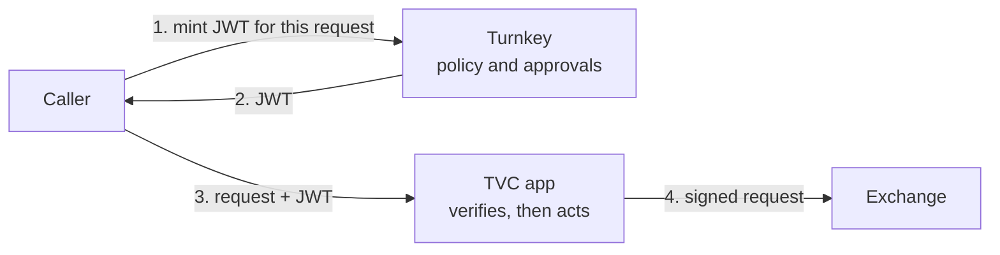

import { FeatureCard } from '/snippets/feature-card.mdx'
import { SolutionCard } from '/snippets/solution-card.mdx'
import { MintJwtCallout } from '/snippets/mint-jwt-callout.mdx'

<MintJwtCallout />

## Who can call your app?

A [TVC](/features/verifiable-cloud/overview) app can hold keys that move money, such as [exchange API keys](/solutions/verifiable-cloud/enclave-only-secrets). Protecting the key is half the job. The other half is deciding who may ask the app to use it.

If the app trusts an API key held by your backend, anyone who compromises the backend can call it. With [Mint JWT](/features/mint-jwt), the app instead accepts only requests that carry a Turnkey-signed JWT. Turnkey's policy engine decides who gets one, and each token authorizes one exact request.



<Info>
  The examples on this page use exchange API keys. The same pattern works for any TVC app that needs to authenticate its callers.
</Info>

## Who approves

| | Trading firm | Consumer trading platform |
| :--- | :--- | :--- |
| Who holds the venue key | The firm's own organization | Each customer's [sub-organization](/features/sub-organizations) |
| Who mints | A service user | Your strategy user for orders, if the customer allows it. The customer for withdrawals |
| Who sets the rules | Your administrator quorum | The customer, in their own sub-organization |
| What the platform can't do | Withdraw without the administrators | Act outside the policies the customer sets |

### Trading firm: administrator quorum

Your trading system mints tokens as a service user. Orders need only the service user. Withdrawals also need two administrators:

```json
{
  "policyName": "Withdrawal tokens need two administrators",
  "effect": "EFFECT_ALLOW",
  "consensus": "approvers.any(u, u.id == '<TRADING_SERVICE_USER_ID>') && approvers.filter(u, u.tags.contains('<ADMIN_TAG_ID>')).count() >= 2",
  "condition": "activity.type == 'ACTIVITY_TYPE_MINT_JWT' && jwt.profile.httpz.audience == 'https://app.example.com' && jwt.profile.httpz.method == 'POST' && jwt.profile.httpz.path == '/withdrawals'"
}
```

The `jwt.profile.httpz` policy fields are coming soon. See [Mint JWT](/features/mint-jwt#who-can-mint) for the order policy.

### Consumer trading platform: the customer approves

Your platform runs trading strategies for customers on their own exchange accounts. Auth to your app is non-custodial: each customer owns the policies that decide who can mint tokens for their account, and your platform can't change them.

1. Each customer gets a sub-organization and is its root user. They import their exchange API key there, so it never passes through your systems.
2. Your TVC app has a [delegated access](/features/policies/delegated-access/overview) user in the sub-organization. Policy lets only that user export the key, encrypted to the app's enclave.
3. The customer writes a policy that lets your strategy user mint order tokens for their account:

   ```json
   {
     "policyName": "My strategy can place orders for me",
     "effect": "EFFECT_ALLOW",
     "consensus": "approvers.any(u, u.id == '<STRATEGY_USER_ID>')",
     "condition": "activity.type == 'ACTIVITY_TYPE_MINT_JWT' && jwt.profile.httpz.audience == 'https://app.example.com' && jwt.profile.httpz.method == 'POST' && jwt.profile.httpz.path == '/orders'"
   }
   ```

4. No policy allows withdrawal tokens, so only the customer can mint one, with their passkey.
5. The app checks that the token's `org` is the customer's sub-organization, and that `sub` may call that route: the strategy user for orders, the customer for withdrawals.

The customer can delete the policy at any time to stop automated trading. Give your delegated users no permission to create or edit policies, so your platform can only act within the rules each customer sets. Customers can also [verify the app's code](/features/verifiable-cloud/proofs-and-verification) before they import their key.

## What the app checks

For every request, the app [verifies the token](/features/mint-jwt#verify-a-token):

- The signature, against Turnkey's published keys for the issuer.
- The audience is the app's own origin, and the token hasn't expired.
- The token's method, path, query, and body digest match this request.
- The subject and organization may make this request.

In Rust, [`turnkey_jwt_profiles`](https://docs.rs/turnkey_jwt_profiles) does these checks for you.

## Getting set up

<Steps>
  <Step title="Deploy the app">
    Deploy your app on TVC and give it the venue keys it needs. See [Enclave only secrets](/solutions/verifiable-cloud/enclave-only-secrets).
  </Step>
  <Step title="Require a JWT on every route">
    Reject any request without a valid Turnkey JWT for that exact request.
  </Step>
  <Step title="Write the minting policies">
    Decide who mints each kind of request and who approves. Keep the quorum at 1 while you build, and raise it before production.
  </Step>
  <Step title="Mint from your clients">
    Call `mintJwt` from your trading system or your customer's app, then send the request with the token.
  </Step>
</Steps>

## Get started

[Contact us](https://www.turnkey.com/contact-us) to enable Mint JWT and design your app's authorization with our team.

<div style={{display: 'grid', gridTemplateColumns: 'repeat(2, 1fr)', gap: '12px'}}>
  <FeatureCard title="Mint JWT" icon="file-shield-02" href="/features/mint-jwt" description="Request-bound JWTs signed after policy approval." />
  <SolutionCard title="Enclave only secrets" icon="tvc" href="/solutions/verifiable-cloud/enclave-only-secrets" description="Use your most critical keys only inside an attested app." />
  <FeatureCard title="Sub-organizations" icon="dataflow-02" href="/features/sub-organizations" description="Give each customer their own organization and keys." />
  <FeatureCard title="Turnkey Verifiable Cloud" icon="cpu-chip-01" href="/features/verifiable-cloud/overview" description="Deploy apps with verifiable code and secure keys." />
</div>
