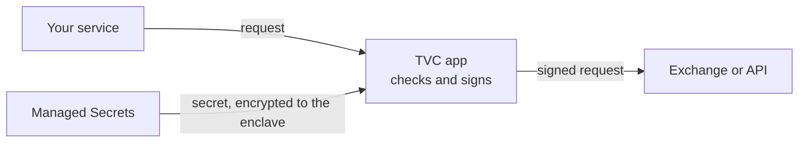

import { FeatureCard } from '/snippets/feature-card.mdx'
import { SolutionCard } from '/snippets/solution-card.mdx'
import { SecretsPricingCallout } from '/snippets/secrets-pricing-callout.mdx'

<SecretsPricingCallout />

## One store, one access model

Most teams keep every secret in one store: a vault server, a password manager, or a cloud secrets service. A chat webhook and an exchange withdrawal key sit side by side. Anyone who administers the store can usually read both.

Turnkey gives each secret the controls it needs. Secrets are encrypted inside [secure enclaves](/security/secure-enclaves), every release is checked by [policy](/features/policies/overview) and logged, and each release is encrypted to one recipient.

## Sort secrets by blast radius

| Tier | Examples | If it leaks | In Turnkey |
| :--- | :--- | :--- | :--- |
| **Scoped** | Read-only SaaS tokens, webhooks | One tool's data is exposed | Optional. Import for one inventory and audit trail |
| **Pivot** | Production database credentials, CI deploy tokens, write-access Git tokens | An attacker moves laterally | Released to the one service that needs it |
| **Root** | Cloud admin credentials, KMS master keys | The whole company is compromised | Every release needs approval from several people |
| **Irreversible** | Exchange withdrawal keys, code-signing keys | Funds are gone, signatures stay valid | Never released. Used only inside an [attested app](/solutions/verifiable-cloud/enclave-only-secrets) |

## What changes

| | Typical secrets manager | Turnkey |
| :--- | :--- | :--- |
| Administrator access | An admin can usually read any secret | No one acts alone. Only a [root quorum](/features/users/root-quorum) you size, such as 3 of 5, can bypass policy |
| Approvals | Missing, or a paid add-on | Built in: require any number of approvers |
| Rules | Paths or folders that teams keep consistent | Policies on fixed properties such as `env` and `owner`, so one rule covers a whole class of secrets |
| Released secret | Plaintext to the caller | Encrypted to one recipient. Proxies and logs see ciphertext |
| Audit | Logs you collect and keep | A signed record of every import, release, and approval |
| Operations | Servers to run and patch, or one cloud's IAM | Managed. Nothing to run |

## Using secrets in practice

Three patterns cover most secrets. Pick one per tier.

### A service fetches its own secret

For pivot secrets. Each service signs in as its own Turnkey user and fetches its secrets at startup. The secret is encrypted to a key the service generates, so only that service can read it.

```typescript
const dbPassword = await turnkey.apiClient().exportSecret({
  secretId,
  requestContext: { env: "prod" },
});
```

### People approve each release

For root secrets. The request waits until enough people approve. Approvers see the request, not the secret. Production database credentials need two SREs and a ticket:

```json
{
  "policyName": "Two SREs and a ticket for prod DB credentials",
  "effect": "EFFECT_ALLOW",
  "consensus": "approvers.filter(u, u.tags.contains('<SRE_TAG_ID>')).count() >= 2",
  "condition": "activity.type == 'ACTIVITY_TYPE_EXPORT_SECRETS' && secret.static_properties['kind'] == 'dbCredential' && secret.static_properties['env'] == 'prod' && request_context['ticket'] != ''"
}
```

Policies can also limit access to [working hours](/features/policies/time-based-policies) or to one service.

### An enclave uses the secret

For irreversible secrets, such as an exchange withdrawal key. The secret never reaches a normal machine:



1. Policy lets only one [Turnkey Verifiable Cloud](/features/verifiable-cloud/overview) app export the secret, encrypted to that app's enclave.
2. Your service sends the app a request. The app checks it against your rules, such as an address allowlist.
3. The app uses the secret inside the enclave, for example to sign the request, and returns or sends the result.

Your administrators approve every version of the app, so the code that holds the secret can't change without them. See [Enclave only secrets](/solutions/verifiable-cloud/enclave-only-secrets) for the full setup.

## Migration

<Steps>
  <Step title="Sort">
    List your secrets, without values. Give each one a tier, an owner, and the services that use it.
  </Step>
  <Step title="Set up">
    Create a Turnkey organization, enroll administrators with security keys, and create a user for each service. Keep the [root quorum](/features/users/root-quorum) at 1 while you test, and raise it, such as to 3 of 5, before you move production secrets.
  </Step>
  <Step title="Move the critical secrets first">
    Import root and irreversible secrets with approval policies. This proves the model where it matters most.
  </Step>
  <Step title="Move the rest">
    Import the remaining secrets with a script, and switch each service to fetch its secrets at startup. See [API key storage](/solutions/key-management/api-key-storage) for the code.
  </Step>
  <Step title="Turn the old store off">
    When the old store shows no reads, delete its secrets and shut it down.
  </Step>
</Steps>

For short-lived cloud credentials, use your cloud's workload identity instead of a stored secret. For certificates, use a managed private CA.

## Get started

[Contact us](https://www.turnkey.com/contact-us) to plan a migration. We will help you sort your secrets and write the policies.

<div style={{display: 'grid', gridTemplateColumns: 'repeat(2, 1fr)', gap: '12px'}}>
  <SolutionCard title="Enclave only secrets" icon="tvc" href="/solutions/verifiable-cloud/enclave-only-secrets" description="Use your most critical keys only inside an attested app." />
  <SolutionCard title="API key storage" icon="api-key-storage" href="/solutions/key-management/api-key-storage" description="Release API keys to an authorized service under policy." />
  <FeatureCard title="Managed Secrets" icon="lock-01" href="/features/secrets" description="How secrets are stored and released." />
  <FeatureCard title="Policy Engine" icon="file-shield-02" href="/features/policies/overview" description="Approvals, conditions, and time windows." />
</div>
