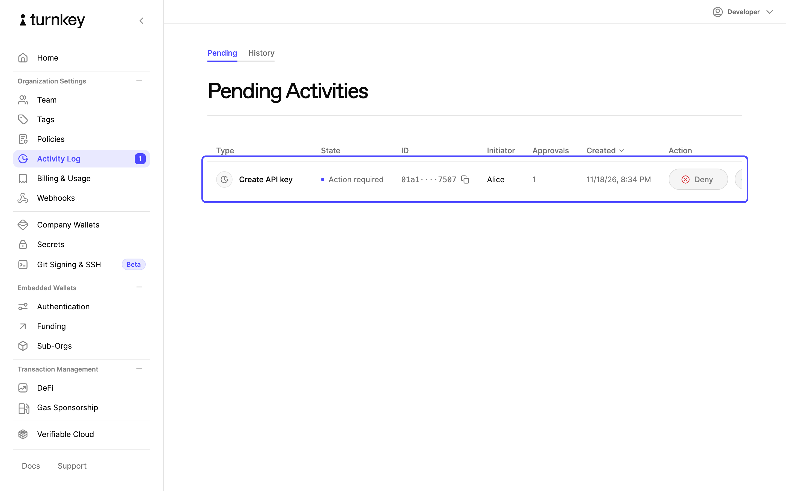
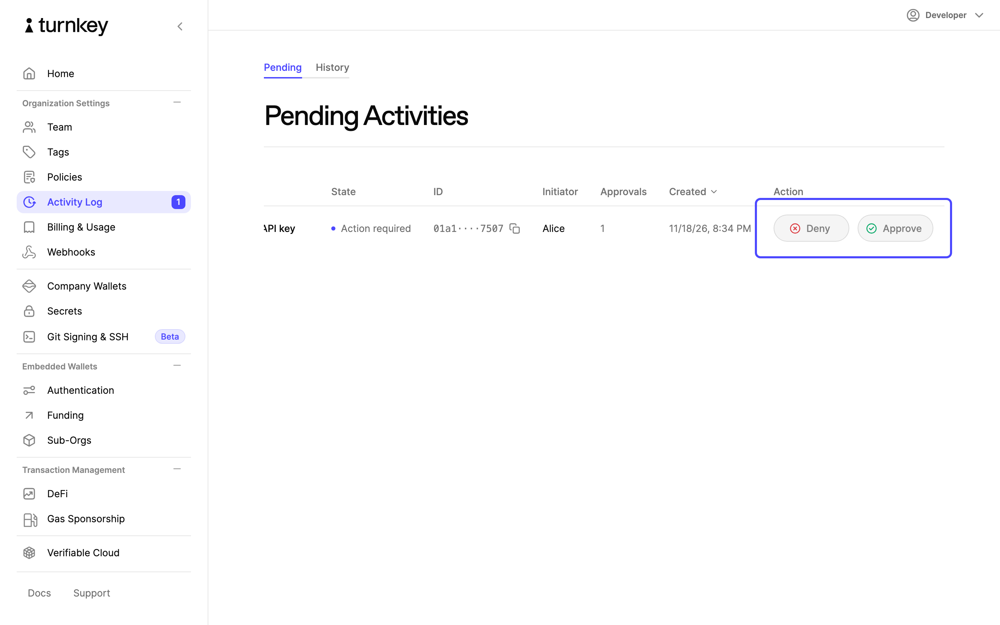
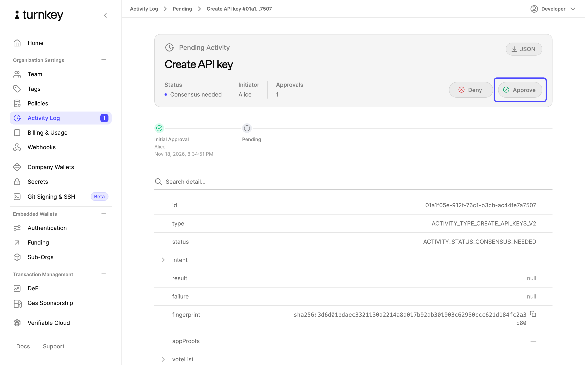
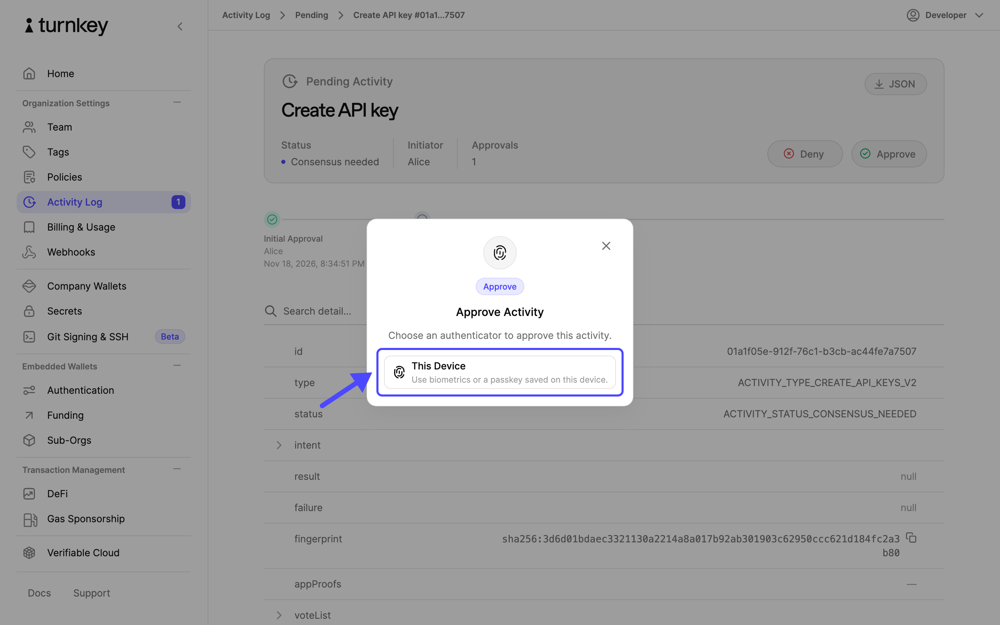
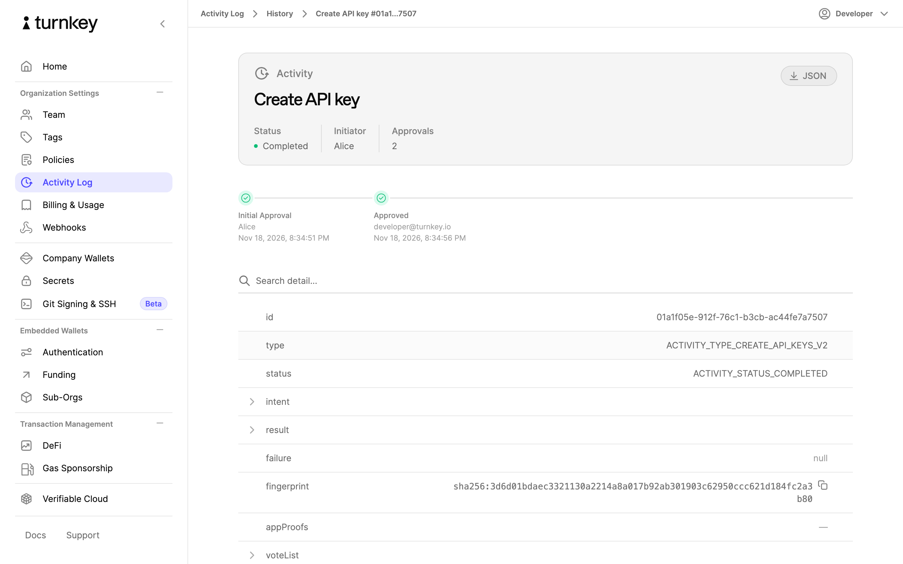
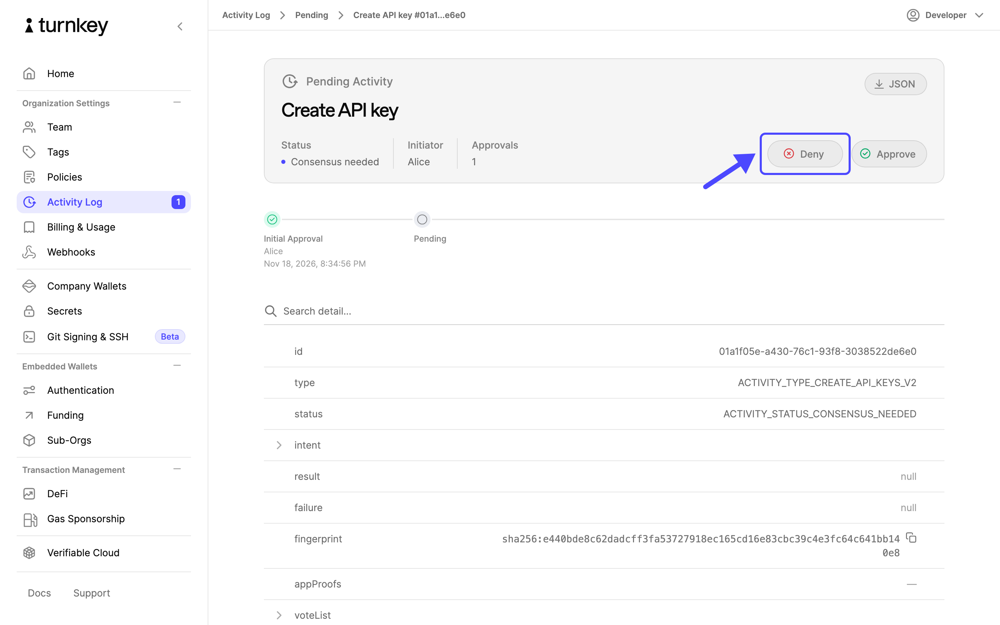
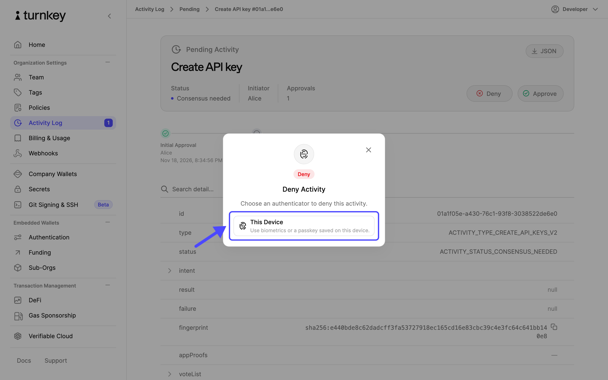
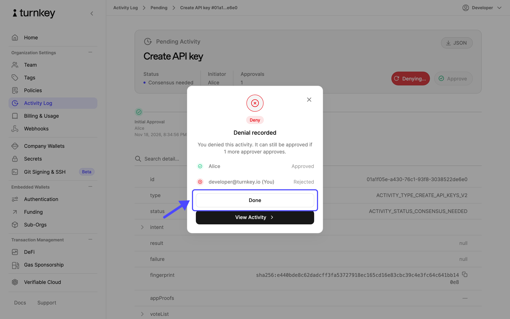
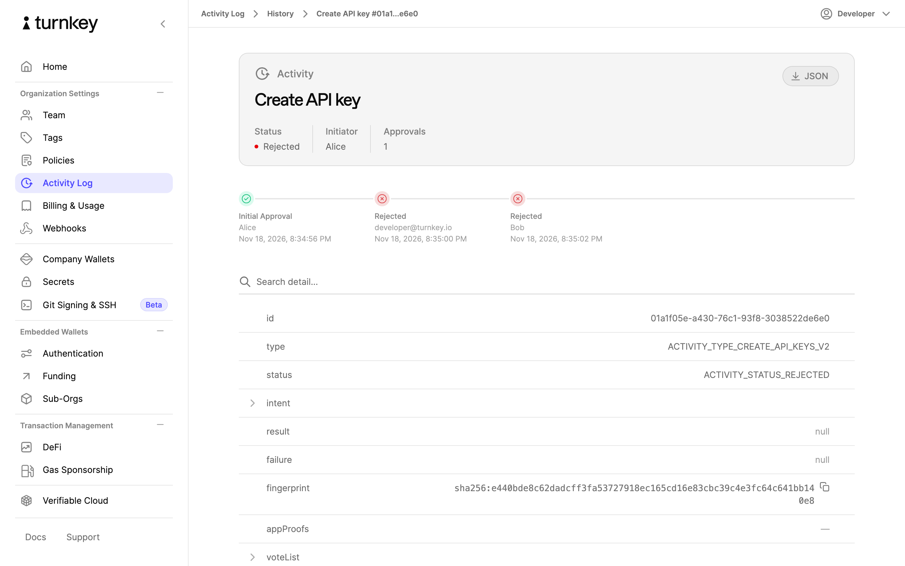

{/* Generated by `npm run document-flows -- approve-pending-activity` in src/js/apps/dashboard. Edit the prose freely; re-run the flow to refresh the images. */}

Some activities do not run as soon as they are submitted. When an activity needs more approvals
than the person who started it can give, it waits in the **Activity Log** of the
[Turnkey dashboard](https://app.turnkey.com) until enough other users approve it. This is called
consensus. This page shows how to approve or deny an activity that is waiting for your vote.

An activity waits for consensus when:

- It needs the [root quorum](/features/users/root-quorum), for example an update to the root
  quorum itself or any action that no policy allows, and the root quorum threshold is 2 or more.
- A [policy](/features/policies/overview) allows it only with the approval of additional users,
  through the policy's [consensus](/features/policies/language#consensus) condition.

Before you start, keep the following in mind:

- You vote on activities that someone else started. Starting an activity already counts as that
  user's approval, so you cannot approve your own. The examples below start from an activity that
  another root user, Alice, submitted and that needs one more approval.
- For an activity that needs the root quorum, only root users can vote. For a policy with
  consensus, only the users the policy names as approvers can.
- Each user votes once on an activity, either to approve or to deny it.
- Approving and denying each require approval from one of your authenticators, so keep your
  passkey or security key handy.
- A service user has no dashboard login. It votes through the API with the
  [approve activity](/api-reference/activities/approve-activity) and
  [reject activity](/api-reference/activities/reject-activity) endpoints.

If you start a consensus-gated action yourself, the dialog closes with an **Activity pending
approval** toast. Its **View** link opens the activity, and the action takes effect only once
enough other users approve it.

The steps below use an organization with three root users and a root quorum threshold of 2.

<Steps>
  <Step title="Find the pending activity">
    In the left navigation, select **Activity Log**; the badge next to it counts the activities waiting for your vote. The **Pending** tab lists every activity that still needs approvals. Each row shows the activity's type and state, who started it under **Initiator**, how many approvals it has so far, and when it was created. A row whose state is **Action required** is waiting for your vote. You cannot approve an activity you started yourself, because starting it already counts as your approval.

    <Frame>
      
    </Frame>
  </Step>

  <Step title="Vote from the list">
    Scroll the row to the right to reach the **Action** column. You can select **Approve** or **Deny** here without opening the activity. To review the request first, select the row to open the activity page, as the next steps do.

    <Frame>
      
    </Frame>
  </Step>

  <Step title="Review and approve">
    The activity page shows what was requested, who started it, and who has voted so far. Review the details, then select **Approve**.

    <Frame>
      
    </Frame>
  </Step>

  <Step title="Confirm with your authenticator">
    Choose **This Device**, as shown in the screenshot, or another authenticator option from the dialog, such as a security key.

    <Frame>
      
    </Frame>
  </Step>

  <Step title="Activity approved">
    Your vote is recorded on the activity. If it meets the threshold, the activity runs right away and moves to the **History** tab. Otherwise it stays on the **Pending** tab, marked **Awaiting consensus**, until enough other users approve it.

    <Frame>
      
    </Frame>
  </Step>

  <Step title="Deny an activity">
    To stop an activity instead, open it from the **Pending** tab in the same way and select **Deny**.

    <Frame>
      
    </Frame>
  </Step>

  <Step title="Confirm with your authenticator">
    Confirm the denial with your authenticator, as before.

    <Frame>
      
    </Frame>
  </Step>

  <Step title="Denial recorded">
    Your denial is recorded on the activity, and the dialog lists every vote so far. A single denial does not cancel the activity: it can still run if enough other users approve it. Select **Done**.

    <Frame>
      
    </Frame>
  </Step>

  <Step title="Activity rejected">
    Once as many root users as the quorum threshold have denied the activity, it is rejected and does not run. It stays visible on the **History** tab with every vote.

    <Frame>
      
    </Frame>
  </Step>
</Steps>
