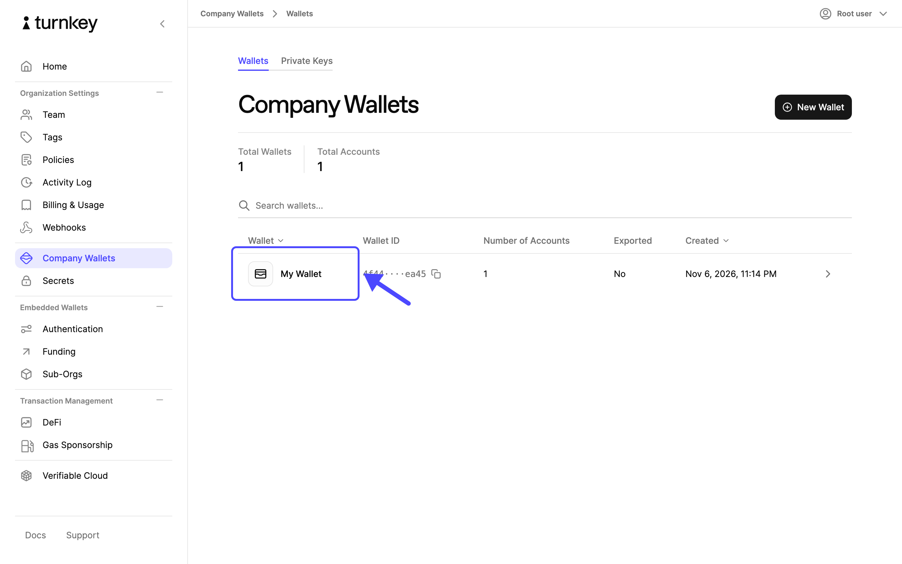
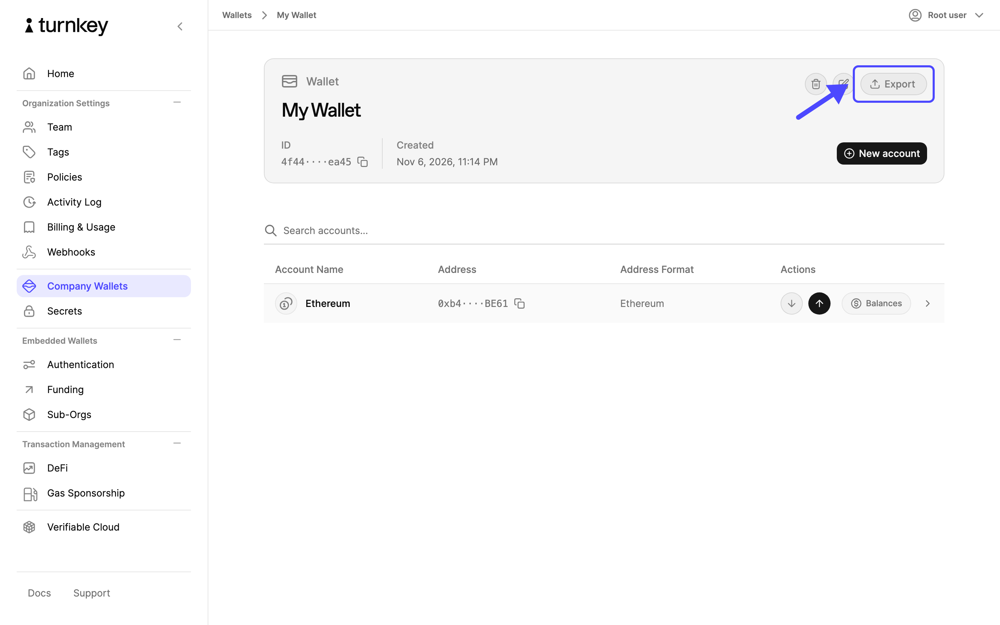
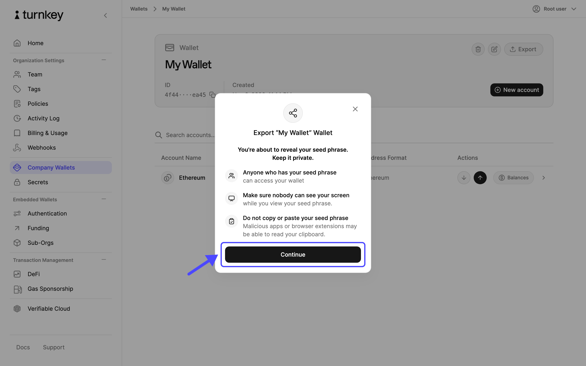
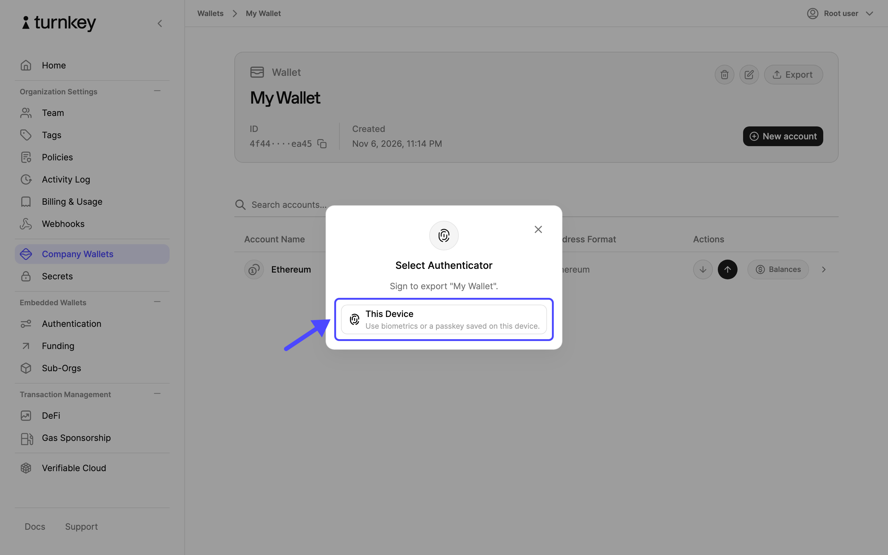
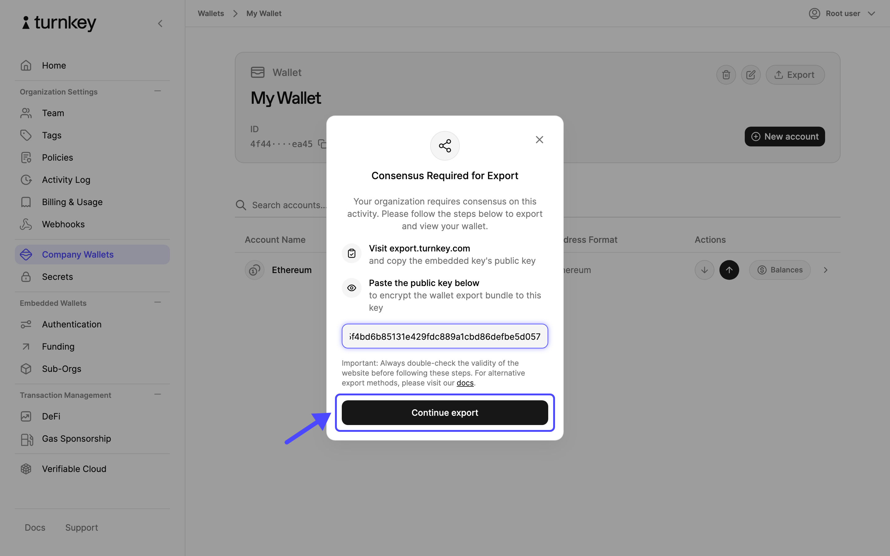
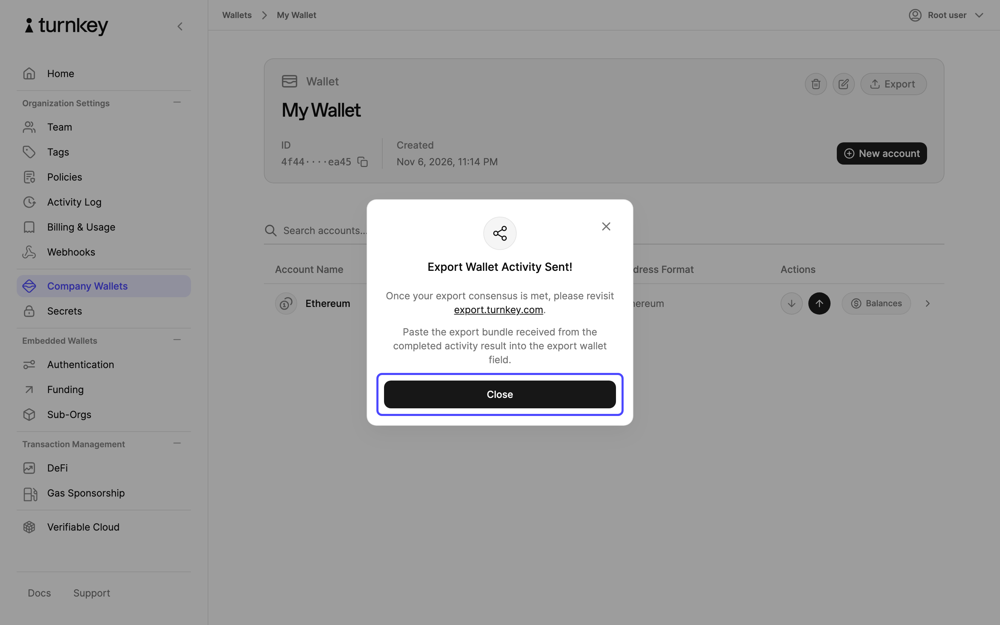
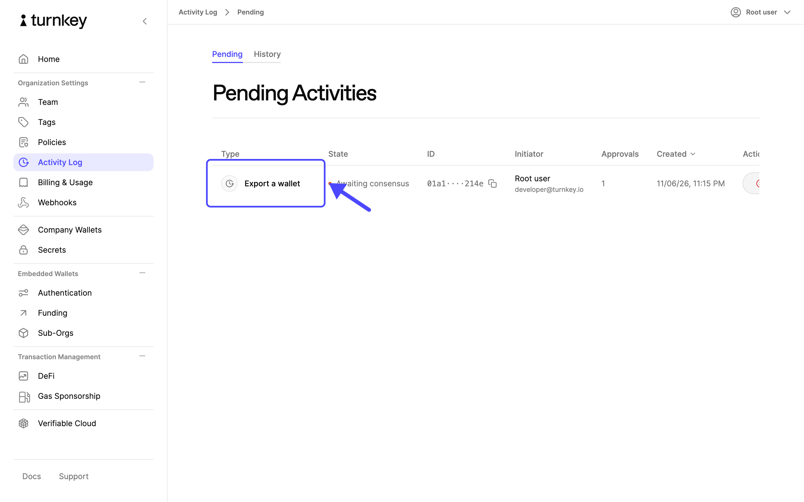
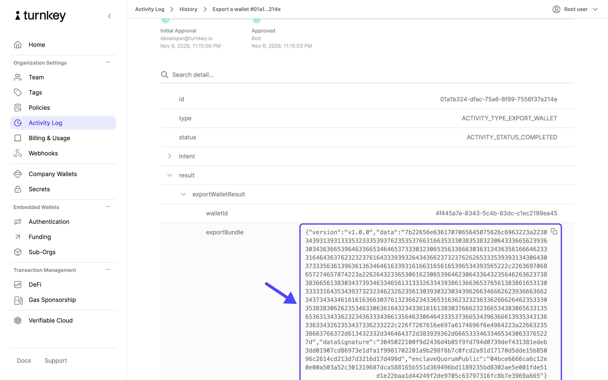

{/* Generated by `npm run document-flows -- export-wallet` in src/js/apps/dashboard. Edit the prose freely; re-run the flow to refresh the images. */}

You can export any wallet in your organization from the **Company Wallets** page of the
[Turnkey dashboard](https://app.turnkey.com). Exporting reveals the wallet's seed phrase, the
[BIP-39 mnemonic](https://learnmeabitcoin.com/technical/mnemonic) that every account in the wallet
derives from. With it you can recreate every address in the wallet, including accounts you add
later, in any other wallet software. This page covers wallets in your parent organization, which
is the organization you sign in to. To export a wallet that belongs to a sub-organization, use
the [export activity](/features/wallets/export-wallets) from your application or a script. You
might want to export a wallet if:

- You want an offline backup of the wallet's key material that does not depend on Turnkey.
- You are moving funds or operations to another wallet provider.
- You are decommissioning the wallet and want to keep access to any funds that arrive later.

Before you start, keep the following in mind:

- Turnkey never sees the seed phrase. A Turnkey enclave encrypts it to a key that exists only in
  your browser, and your browser decrypts and displays it. See
  [how export works](/features/wallets/export-wallets#how-it-works) for the details.
- The wallet stays in Turnkey after the export and keeps signing as before. Its **Exported**
  column changes to **Yes** and stays that way. There is no way to mark a wallet as not exported
  again, so an export is a permanent record that the seed phrase has left Turnkey.
- Standalone private keys have their own **Export** button on the **Private Keys** tab. The steps
  are the same, and the dialog reveals the private key instead of a seed phrase.
- Exporting a single account's private key, rather than the whole seed phrase, is only available
  through the [export wallet account activity](/api-reference/activities/export-wallet-account).

<Warning>
  Anyone who has the seed phrase controls every account in the wallet, and Turnkey's policies and
  approvals no longer apply to them. Make sure nobody can see your screen, write the seed phrase
  down rather than copying it, and store it somewhere only the right people can reach.
</Warning>

Exporting a wallet requires approval from one of your authenticators, so keep your passkey or
security key handy.

<Steps>
  <Step title="Open the Wallets page">
    In the left navigation, select **Company Wallets**, then select the wallet you want to export.

    <Frame>
      
    </Frame>
  </Step>

  <Step title="Open the export dialog">
    On the wallet's page, select **Export**.

    <Frame>
      
    </Frame>
  </Step>

  <Step title="Review the warnings">
    Read the warnings. Make sure nobody can see your screen, and plan to write the seed phrase down rather than copy it. Select **Continue**.

    If the dialog is titled **Consensus Required for Export** instead, your organization's root
    quorum needs more than one approval. Follow
    [Export when your organization requires consensus](#export-when-your-organization-requires-consensus)
    below.

    <Frame>
      
    </Frame>
  </Step>

  <Step title="Approve the export">
    Confirm with your authenticator. Choose **This Device** to use a passkey, as shown in the screenshot,
    or another authenticator option from the modal, such as a security key.

    <Frame>
      
    </Frame>
  </Step>

  <Step title="Save the seed phrase">
    The dialog is replaced by a **Seed Phrase** panel that shows the words in order. Write them
    down, check them against the screen, and select **Done** when you are finished. The seed
    phrase is not shown again. If you lose it, run the export again to reveal it.

    Back on the wallet list, the wallet's **Exported** column now reads **Yes**.
  </Step>
</Steps>

## Export when your organization requires consensus

If your [root quorum](/features/users/root-quorum) has a threshold above 1, the export cannot
finish in the browser the way it does for a single approver. The export activity waits for the
other approvals, and the encrypted bundle only exists once they arrive. The dashboard therefore
asks you to supply the encryption key up front from Turnkey's hosted export page, and you bring
the bundle back to that same page once the activity completes.

<Steps>
  <Step title="Copy the embedded key">
    Open [export.turnkey.com](https://export.turnkey.com) in a new tab of the same browser. Under
    **Export Key Material**, copy the value labelled **Embedded key**. This is the public half of
    a key pair that the page generated and stored in this browser's local storage.

    Do not paste a public key you generated yourself with a script. The export page can only
    reveal the seed phrase if the bundle was encrypted to the key it holds.
  </Step>

  <Step title="Paste the embedded key">
    Back in the dashboard, select **Export** on the wallet's page as before. Because your root
    quorum needs more than one approval, the dialog is titled **Consensus Required for Export**
    and asks for a public key. Paste the embedded key and select **Continue export**, then approve
    with your authenticator.

    <Frame>
      
    </Frame>
  </Step>

  <Step title="Export activity sent">
    The export is now a pending activity. Nothing is revealed until the other root quorum members
    approve it.

    <Frame>
      
    </Frame>
  </Step>

  <Step title="Wait for the approvals">
    In the left navigation, select **Activity Log**. The export sits on the **Pending** tab until
    enough root quorum members approve it. They approve it from this same tab in their own
    dashboard, or with the [approve activity](/api-reference/activities/approve-activity)
    endpoint. Approvals do not depend on the embedded key, so they can come from any browser or
    device.

    <Frame>
      
    </Frame>
  </Step>

  <Step title="Copy the export bundle">
    Once approved, the activity moves to the **History** tab. Open it, expand **result**, then
    **exportWalletResult**, and copy the **exportBundle** value.

    <Frame>
      
    </Frame>
  </Step>

  <Step title="Reveal the seed phrase">
    Return to the [export.turnkey.com](https://export.turnkey.com) tab from step 1. Under
    **Inject Wallet Export Bundle**, paste the bundle into **Bundle** and your organization ID
    into **Organization Id**, then select **Inject Bundle**. The page decrypts the bundle and
    shows the seed phrase.
  </Step>
</Steps>

<Warning>
  The private key that decrypts the bundle lives only in the export page's local storage in the
  browser where you copied the embedded key. Do not clear that site's data, use a private window,
  switch browsers, or select **Reset Key** between submitting the export and injecting the bundle.
  If the key is gone, the bundle cannot be decrypted. Start the export again from the dashboard.
</Warning>

If you would rather not rely on a browser tab staying intact while approvals come in, run the
export from a script instead: generate your own P-256 key pair, submit the
[export wallet activity](/api-reference/activities/export-wallet) with its public key, and decrypt
the bundle locally once the activity completes. The
[export-in-node](https://github.com/tkhq/sdk/tree/main/examples/key-management/export-in-node)
example handles the wait for approvals.

## Restricting who can export

Export is an activity like any other, so [policies](/features/policies/overview) decide which
users can run it. A policy that denies `ACTIVITY_TYPE_EXPORT_WALLET` and
`ACTIVITY_TYPE_EXPORT_PRIVATE_KEY` for a user or tag stops those users from exporting; the
dashboard still shows the **Export** button, but the activity is rejected when they approve it.

Policies do not apply to the root quorum. A root quorum with a threshold of 1 can always export,
and there is no setting that removes this ability from root users. To require a second person
for every export, raise the root quorum threshold above 1. Each export then goes through the
consensus flow above. Keep in mind that the threshold applies to every root action, not only
exports. See [root quorum best practices](/features/users/root-quorum#best-practices) for how to
structure this.

Every export is recorded in the **Activity Log** and is delivered to your
[webhooks](/features/webhooks/overview), so you can monitor for exports even when you cannot prevent them.
