{/* Generated by `npm run document-flows -- update-root-quorum` in src/js/apps/dashboard. Edit the prose freely; re-run the flow to refresh the images. */}

You can change who is in your organization's [root quorum](/features/users/root-quorum), and
how many of those users must approve a root action, from the **Team** page of the
[Turnkey dashboard](https://app.turnkey.com). Promoting a user from **Basic** to **Root** adds
them to the quorum, and demoting a root user to **Basic** removes them. This applies to your
parent organization, which is the organization you sign in to. To change the root quorum of a
sub-organization, use the [update root quorum activity](/api-reference/activities/update-root-quorum).
You might want to update the root quorum if:

- You are adding a root user so that root access no longer depends on one person or one
  credential.
- You are raising the threshold so that no single root user can act alone. The
  [production checklist](/get-started/production-checklist#security) recommends at least three
  root users with a threshold of at least two.
- Someone is leaving your team. Remove them from the quorum before they go, not after.

Before you start, keep the following in mind:

- Only a user who is already in the root quorum can change it. Policies cannot grant this
  permission. If you are not a root user, the Root Quorum page is read-only and another root
  user has to make the change.
- Changing the root quorum is itself a root action, so it needs as many approvals as the
  current threshold. With a threshold of 1 your approval applies the change right away. With a
  threshold of 2 or more, the change waits in the **Activity Log** until enough other root users
  approve it. The steps below show this second case.
- When the threshold equals the number of root users, such as 1/1 or 2/2, every root user has
  to approve every root action, including a change to the quorum itself. If one of them loses
  access, the organization is locked out of root actions. The dashboard labels these quorums
  **Single point of failure** (one root user) or **Lockout risk**. Keep the threshold below the
  number of root users.
- Give every root user more than one credential, such as a second passkey or a security key,
  so that a lost device does not cost them access to their account.
- The root quorum bypasses [policies](/features/policies/overview) entirely, so add only users
  who need that level of access.

<Warning>
  Always keep at least one root user who can sign in to the dashboard, and keep the threshold
  reachable with credentials that still work. If the remaining root users cannot meet the
  threshold, neither you nor Turnkey can change the quorum back.
</Warning>

The steps below start from an organization with two root users and a threshold of 2. They
promote a third user to reach 2/3, then demote that user again.

<Steps>
  <Step title="Open the Team page">
    In the left navigation, select **Team**. The stats above the list show how many root users your organization has and the current threshold. Next to **Root Quorum**, select **Edit**. Only a user who is already in the root quorum can change it. Anyone else can open the page but cannot edit it, and sees "You must already be part of the root quorum to update it."

    <Frame>
      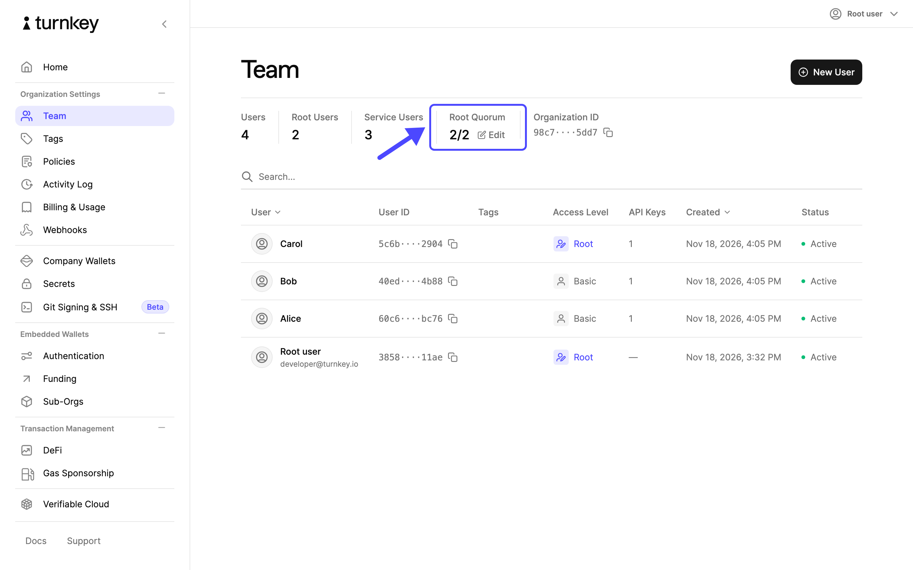
    </Frame>
  </Step>

  <Step title="Find the user to promote">
    The Root Quorum page lists every user in your organization as **Root** or **Basic**. Users labeled **Service User** are API-only and have no dashboard login. Select the Basic user you want to promote.

    <Frame>
      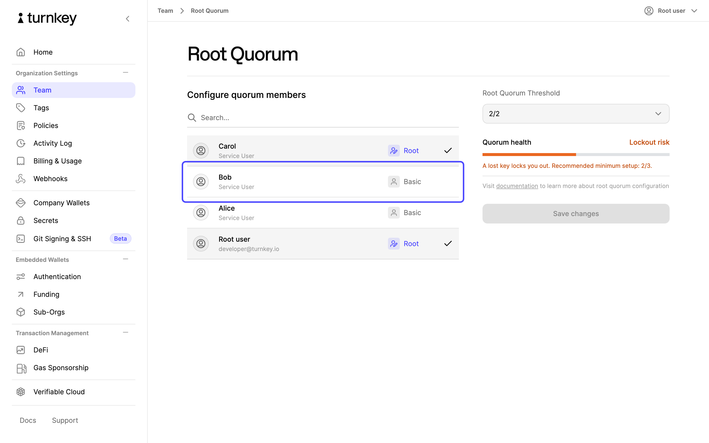
    </Frame>
  </Step>

  <Step title="Check the threshold">
    The user now reads **Root**. **Root Quorum Threshold** is the number of root users who must approve a root action, out of the total. We recommend at least 2/3: a lost credential cannot lock you out, and a stolen one cannot act alone, so **Quorum health** reads **Good to go**. See the [production checklist](/get-started/production-checklist#security) for the full recommendation.

    <Frame>
      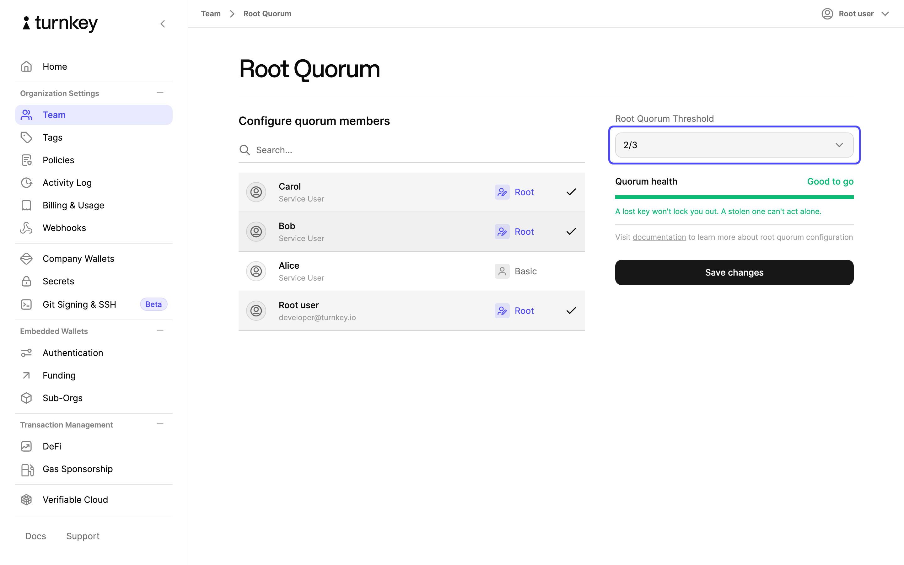
    </Frame>
  </Step>

  <Step title="Save the change">
    Select **Save changes**.

    <Frame>
      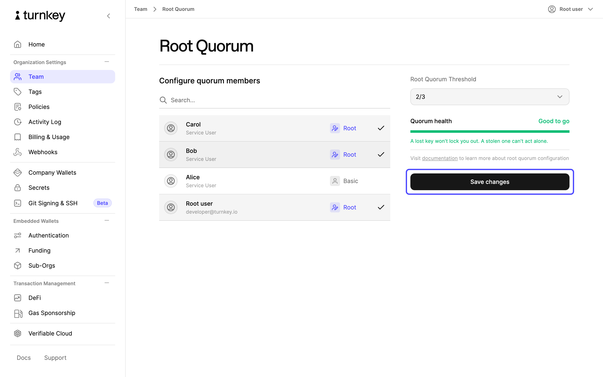
    </Frame>
  </Step>

  <Step title="Approve the change">
    Confirm with your authenticator. Choose **This Device**, as shown in the screenshot, or another authenticator option from the dialog, such as a security key.

    <Frame>
      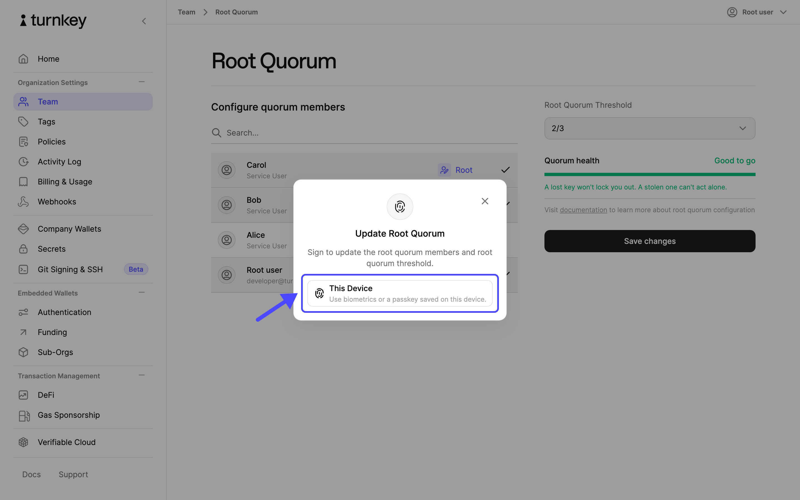
    </Frame>
  </Step>

  <Step title="Wait for the other approvals">
    Changing the root quorum is itself a root action. When the current threshold is 2 or more, your approval alone does not apply the change, and the dialog lists who has approved so far. Select **Done**, or select **View Activity** to open the pending update directly.

    <Frame>
      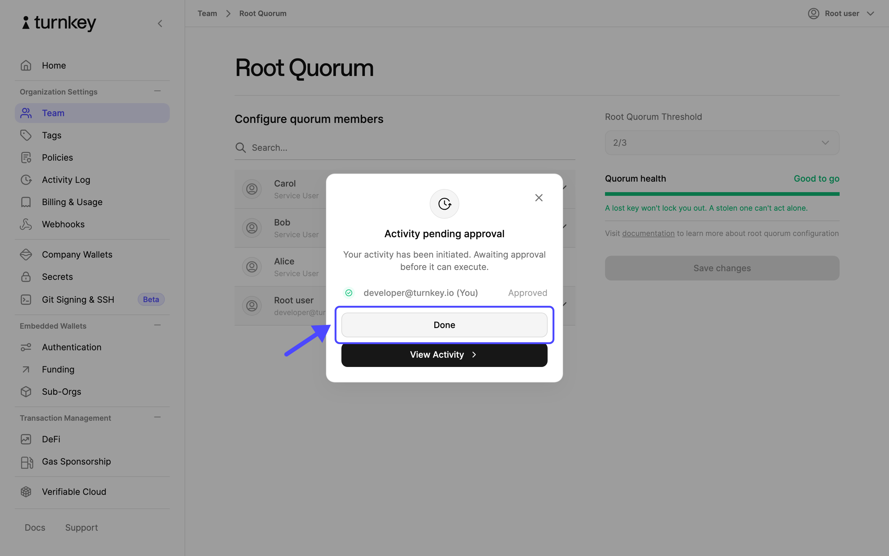
    </Frame>
  </Step>

  <Step title="Find the pending update">
    In the left navigation, select **Activity Log**. The update sits on the **Pending** tab until enough root users approve it. Each of them opens it from this same tab in their own dashboard and approves it there, or approves it with the [Approve activity](/api-reference/activities/approve-activity) API.

    <Frame>
      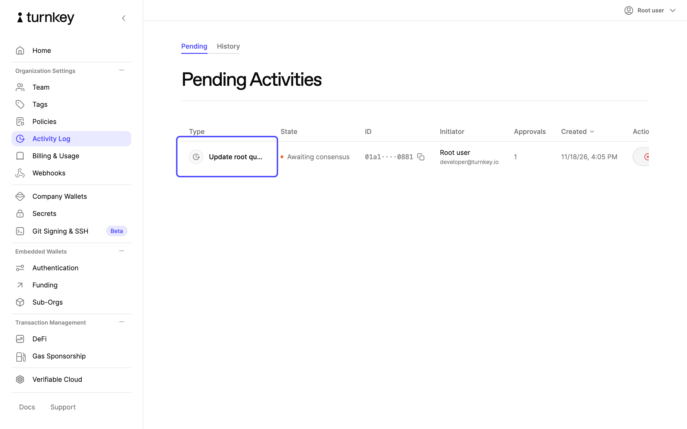
    </Frame>
  </Step>

  <Step title="The update is approved">
    Once the threshold is met, the update runs and moves to the **History** tab. Open it to see who approved it and when.

    <Frame>
      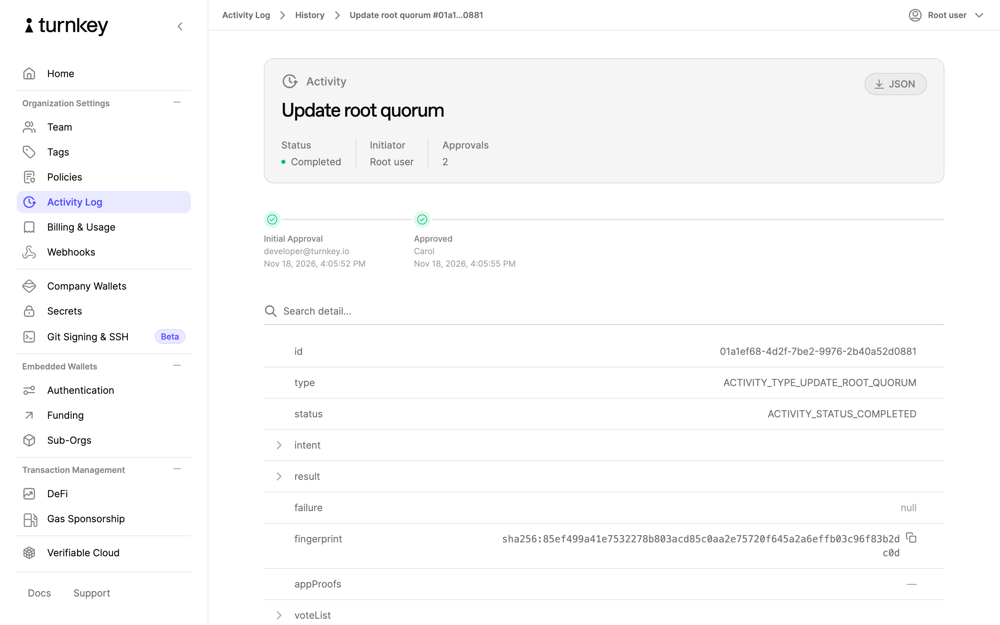
    </Frame>
  </Step>

  <Step title="User promoted">
    Back on the Team page, the user's access level is **Root**, and **Root Quorum** shows the new threshold. To demote a root user, select **Edit** again.

    <Frame>
      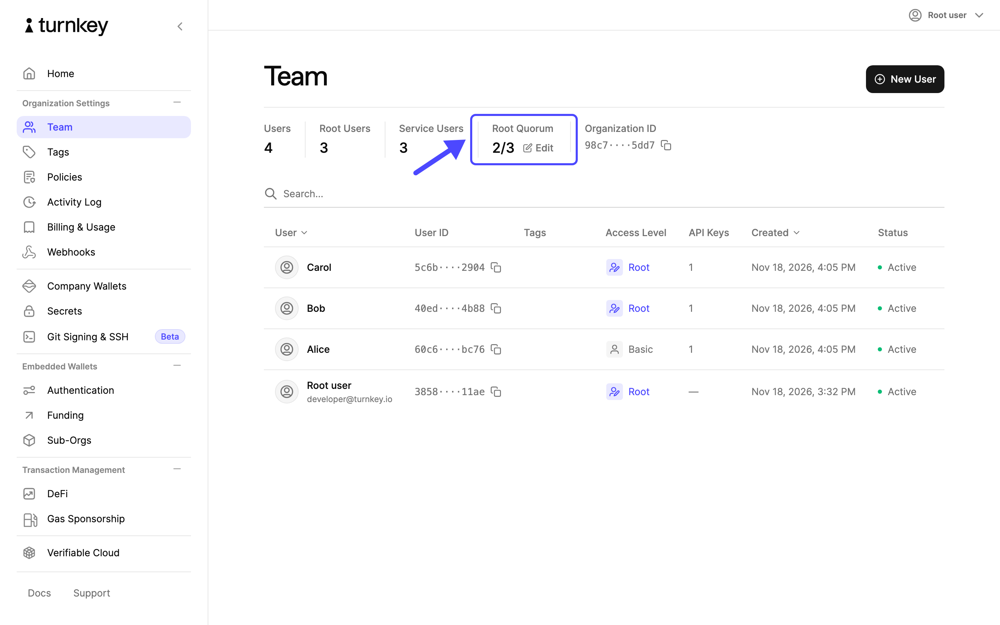
    </Frame>
  </Step>

  <Step title="Demote the user to Basic">
    Select the root user you want to demote so that they read **Basic**. The threshold follows the smaller quorum, here 2/2, and **Quorum health** changes to **Lockout risk**. When the threshold equals the number of root users, every one of them has to approve, so a single root user who loses access locks the organization out of root actions. Never demote the only root user who can sign in to the dashboard: a service user that is left as the sole root user can only change the quorum back through the API. Select **Save changes**.

    <Frame>
      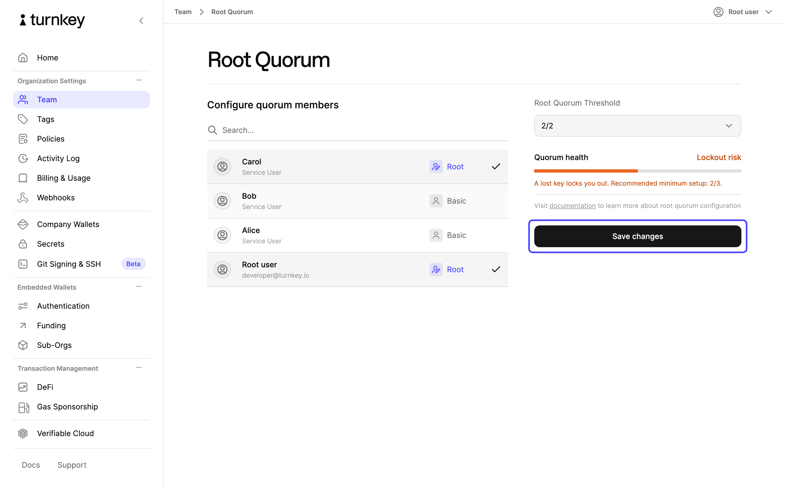
    </Frame>
  </Step>

  <Step title="Review the warning">
    Before it saves, the dashboard asks you to confirm a risky quorum. It appears here because the threshold needs every root user and each of them has only one credential, so one lost passkey or API key is enough to lock the organization out. Giving every root user a second authenticator or API key makes it much less likely that any of them loses access, and the dashboard then stops asking. The quorum still depends on every root user being available, though: only a threshold below the number of root users removes the lockout risk, and the [production checklist](/get-started/production-checklist#security) recommends at least 2/3. The dashboard asks for the same confirmation when there is a single root user, or a threshold of 1 with several root users. To change the quorum, select **Keep editing**. To save it as it is, select **Continue anyway**.

    <Frame>
      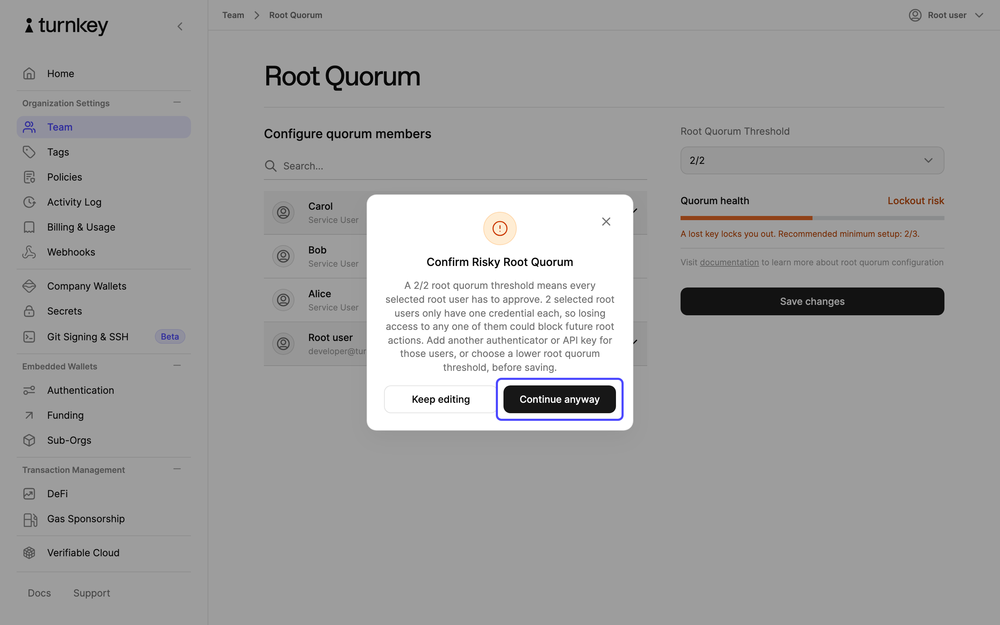
    </Frame>
  </Step>

  <Step title="User demoted">
    Approve with your authenticator, then wait for the other root users to approve the update in the **Activity Log** as before. The Team page then shows the user's access level as **Basic**, and they are no longer counted under **Root Users**.

    <Frame>
      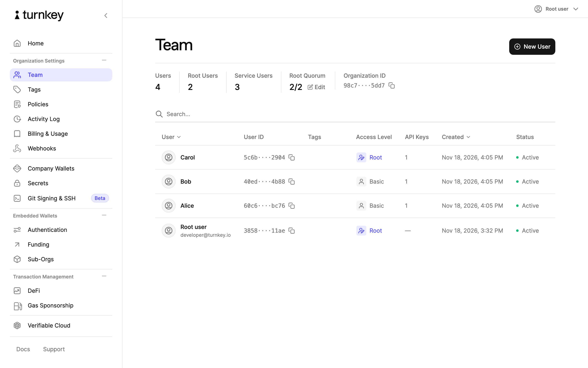
    </Frame>
  </Step>
</Steps>
